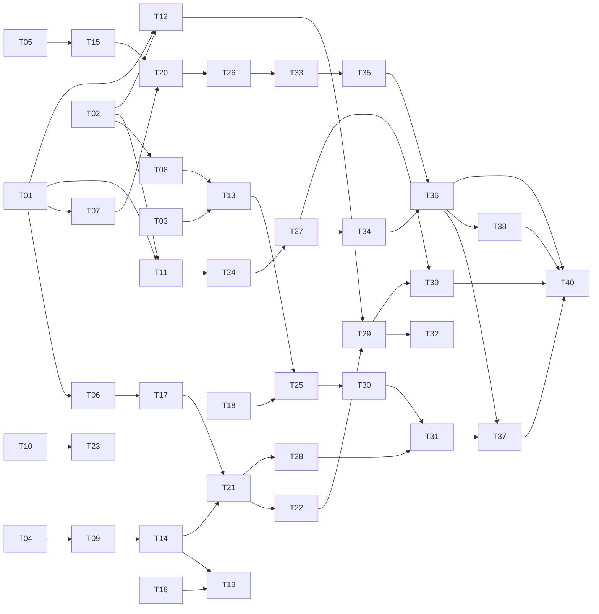

# Task Board — 5 Members × 8 Weeks (40 Tasks)

> **How this works**
> - 5 team members: **M1, M2, M3, M4, M5**. One task per member per week → 40 tasks over ~2 months.
> - Every task has an ID (`T01`–`T40`), an assignee slot, a due week, and **hard dependencies** (`Requires`).
> - A task is **unlocked** only when every `Requires` task shows ✅ Done.
> - When you finish a task in GitHub, mark it with the completion stamp below. The board rules then automatically make dependent tasks available.

## Completion Protocol (GitHub integration)

When closing a task's PR/issue, edit its row in this file and add the stamp:

```
Status: ✅ Done by @github-username on YYYY-MM-DD (PR #NN)
```

Rules the team follows (and that a CI check / GitHub Action can enforce):

1. A task may only be started if all `Requires` tasks carry the ✅ stamp.
2. Only the person named in the stamp may set it; reviewers confirm via PR approval.
3. When a stamp is added, re-scan the board: any task whose last missing dependency just got stamped becomes 🟢 Available for the next weekly slot.
4. Blocked tasks keep 🔴 status until the stamp appears on every prerequisite.
5. If someone cannot take their weekly task, they swap slots with another member **in the same week block** and note it in the task's Notes.

### Status legend
| Icon | Meaning |
|------|---------|
| ⬜ Planned | Not started, dependencies not yet met or week not reached |
| 🟢 Available | All dependencies ✅ — can be claimed this week |
| 🚧 In progress | Claimed & open PR |
| ✅ Done | Stamped with user + date + PR |
| 🔴 Blocked | Dependency slipped; waiting |

---

## Week 1 — Foundations

### T01 · PostgreSQL persistence layer (store interface → repo pattern)
- **Slot:** M1 · **Due:** end of W1 · **Requires:** — · **Status:** 🚧 In progress (Mordret, 2026-10-28)
- Scope: define repository interfaces extracted from `internal/store`, implement Postgres-backed store with `database/sql` + `pgx`, connection pooling, graceful fallback config `DB_DRIVER=memory|postgres`. Keep existing tests green against both drivers.
- Notes: unblocks almost the entire backend track.
- Progress: repository interfaces (`store.Repository` + per-entity sub-interfaces), Postgres implementation (`internal/store/postgres.go`, pgx stdlib, schema bootstrap), `DB_DRIVER` wiring with graceful fallback, and a two-driver conformance suite are landed (4 commits). Remaining before ✅: run the suite against a real PostgreSQL (CI service with `TEST_DATABASE_URL`, which needs the T05 Go CI job).

### T02 · Database migrations tooling
- **Slot:** M2 · **Due:** end of W1 · **Requires:** — · **Status:** ⬜ Planned
- Scope: integrate `goose`, write initial migration files (users, friendships, shares, locations, audit_log, sessions), wire auto-migrate at startup behind `MIGRATE_ON_BOOT`, document rollback procedure in `docs/DEPLOYMENT.md`.
- Notes: coordinates schema with T01; agree table names before coding.

### T03 · Web admin console (`weba`) skeleton
- **Slot:** M3 · **Due:** end of W1 · **Requires:** — · **Status:** ⬜ Planned
- Scope: separate SPA under `weba/` served at `/admin`: login with admin role gate, user list/table, invite & force-password-change actions against existing endpoints; Dockerfile + nginx service in compose.
- Notes: reuse CSRF/session handling patterns from `web/public/app.js`.

### T04 · Kotlin Android project scaffold
- **Slot:** M4 · **Due:** end of W1 · **Requires:** — · **Status:** ⬜ Planned
- Scope: create `mobile/` Gradle (Kotlin DSL) project, Jetpack Compose baseline, MVVM module layout (`app`, `core:network`, `core:data`, `feature:auth`, `feature:map`, `feature:friends`, `feature:sharing`), Retrofit + kotlinx.serialization API client targeting `/api/v1`, debug build flavor pointing at local compose stack.
- Notes: no iOS emulator needed — Android emulator covers the loop (decision recorded in ROADMAP).

### T05 · CI pipeline (build/test/lint/docker)
- **Slot:** M5 · **Due:** end of W1 · **Requires:** — · **Status:** ⬜ Planned
- Scope: GitHub Actions: `go build/vet/test -race` on backend, `node --check` on web JS, hadolint on Dockerfiles, docker compose smoke test (`/health`), artifact upload. Add badge to README.
- Notes: later extended by T06, T14, T22, T35.

---

## Week 2 — Realtime & Admin depth

### T06 · Redis rate limiting + background job queue
- **Slot:** M1 · **Due:** end of W2 · **Requires:** T01 · **Status:** ⬜ Planned
- Scope: move limiter from in-process map to Redis sliding window; introduce asynq (Redis) worker for scheduled tasks (expiry sweep, stale flags); compose service + healthcheck.

### T07 · WebSocket realtime location updates
- **Slot:** M2 · **Due:** end of W2 · **Requires:** T01 · **Status:** ⬜ Planned
- Scope: `/ws` endpoint with JWT/hello auth, hub per-user fan-out on new location events, replace client polling in `web/public` with WS + polling fallback, backpressure & ping/pong keepalive.

### T08 · Audit log (who saw whose location)
- **Slot:** M3 · **Due:** end of W2 · **Requires:** T01, T02 · **Status:** ⬜ Planned
- Scope: `audit_log` writes on every location read/share change, retention policy env var, admin export CSV endpoint, privacy review notes appended to `docs/PRIVACY.md`.

### T09 · Android auth flow (login, session, keystore)
- **Slot:** M4 · **Due:** end of W2 · **Requires:** T04 · **Status:** ⬜ Planned
- Scope: Compose screens for login/forced password change, OkHttp cookie jar, token/session storage in EncryptedSharedPreferences (Android Keystore), refresh/logout invalidation matching backend semantics, unit tests with MockWebServer.

### T10 · Kiosk web client (`webk`) MVP
- **Slot:** M5 · **Due:** end of W2 · **Requires:** — · **Status:** ⬜ Planned
- Scope: minimal public-facing app under `webk/` (family/kiosk view): QR-code share link opens a time-limited, consent-checked single-friend map view; no login, signed short-expiry tokens issued by backend endpoint `POST /api/v1/share-links`.
- Notes: depends conceptually on share model already in Go backend; backend endpoint included in scope.

---

## Week 3 — Persistence hardening & mobile maps

### T11 · Session store in Postgres + multi-device logout
- **Slot:** M1 · **Due:** end of W3 · **Requires:** T01, T02 · **Status:** ⬜ Planned
- Scope: server-side session table replacing stateless-only mode, "log out everywhere", admin session revocation, expiry sweeper via job queue (T06).

### T12 · Location history & retention jobs
- **Slot:** M2 · **Due:** end of W3 · **Requires:** T01, T02, T06 · **Status:** ⬜ Planned
- Scope: query endpoints for history (paginated, consent-filtered), configurable retention (per-share TTL), nightly purge job, stale-state computation moved server-side.

### T13 · `weba` user management complete + roles
- **Slot:** M3 · **Due:** end of W3 · **Requires:** T03, T08 · **Status:** ⬜ Planned
- Scope: role field (user/moderator/admin) enforced in backend middleware, admin UI for role changes, audit-log viewer page, bulk invite CSV.

### T14 · Android map screen (OSM tiles + pins)
- **Slot:** M4 · **Due:** end of W3 · **Requires:** T09 · **Status:** ⬜ Planned
- Scope: osmdroid MapView wrapper in Compose AndroidView, friend pins with freshness colors mirroring web states, precision badges, navigate-export intent (geo URI), offline tile cache policy.

### T15 · Structured logging + request IDs across services
- **Slot:** M5 · **Due:** end of W3 · **Requires:** T05 · **Status:** ⬜ Planned
- Scope: `slog` JSON logger, middleware injecting `X-Request-ID` propagated to logs/WS/audit rows, CI step enforcing no `fmt.Print*` left in handlers, Grafana-less dev viewer script.

---

## Week 4 — Sharing model & notifications

### T16 · Directional share enhancements (pause windows, geofences)
- **Slot:** M1 · **Due:** end of W4 · **Requires:** T11, T12 · **Status:** ⬜ Planned
- Scope: schedule windows (e.g., weekdays 8–18h), circular geofence auto-pause ("share only while at home"), validation + tests, API version bump strategy documented.

### T17 · Push notification service (backend)
- **Slot:** M2 · **Due:** end of W4 · **Requires:** T06, T14 (API contract agreed W3) · **Status:** ⬜ Planned
- Scope: FCM v1 HTTP transport, device-token registration endpoint, notification types (friend request, share started/expiring, low-battery sharing hint), fan-out via job queue, sandbox test mode.

### T18 · `weba` settings & metrics dashboard
- **Slot:** M3 · **Due:** end of W4 · **Requires:** T13, T15 · **Status:** ⬜ Planned
- Scope: server stats endpoint (uptime, active shares, WS connections), charting (lightweight lib), feature flags surfaced from env/config, dark/light theme.

### T19 · Android friends & share-management UI
- **Slot:** M4 · **Due:** end of W4 · **Requires:** T14, T16 (contract) · **Status:** ⬜ Planned
- Scope: friend list/request/inbox screens, directional share create/edit sheet with precision + schedule pickers mirroring T16 semantics, optimistic UI + error states, screenshot tests.

### T20 · Load & concurrency testing suite
- **Slot:** M5 · **Due:** end of W4 · **Requires:** T07, T15 · **Status:** ⬜ Planned
- Scope: k6 scripts for login burst, location publish storm, WS fan-out; CI nightly job with thresholds; report artifacts; tune pools/limiter based on results.

---

## Week 5 — Mobile maturity

### T21 · Android background location scheduler
- **Slot:** M4 · **Due:** end of W5 · **Requires:** T14, T17 (token contract) · **Status:** ⬜ Planned
- Scope: WorkManager periodic + expedited uploads honoring share schedules (T16), foreground service with persistent notification when live-sharing, battery-aware degradation tiers, permission UX (while-in-use vs always), docs update in PRIVACY.

### T22 · Offline-first sync layer (Android)
- **Slot:** M2 · **Due:** end of W5 · **Requires:** T21 (upload queue shape) · **Status:** ⬜ Planned
- Scope: Room DB cache for friends/shares/last-known locations, conflict rule "server consent wins", retry/backoff upload queue surviving reboot, sync status indicator in UI.

### T23 · Share-link QR & deep links (webk ↔ android)
- **Slot:** M5 · **Due:** end of W5 · **Requires:** T10, T21 · **Status:** ⬜ Planned
- Scope: App Links + universal redirect `/.well-known/assetlinks.json`, `webk` page offers "Open in app", token exchange handshake, expiry countdown UI.

### T24 · Email service (invites, security alerts)
- **Slot:** M1 · **Due:** end of W5 · **Requires:** T11 · **Status:** ⬜ Planned
- Scope: SMTP provider abstraction (dev mailhog in compose), templates (invite, password reset, suspicious login), rate-limit abuse guards, async send via queue.

### T25 · `weba` moderation queue
- **Slot:** M3 · **Due:** end of W5 · **Requires:** T13, T18 · **Status:** ⬜ Planned
- Scope: flagged-location reports (report button added to `web` in same PR), moderator actions (hide location, suspend share, freeze account) writing audit entries, role-gated views.

---

## Week 6 — Security & quality hardening

### T26 · Threat model + penetration checklist
- **Slot:** M5 · **Due:** end of W6 · **Requires:** T20, T24 · **Status:** ⬜ Planned
- Scope: STRIDE workshop doc `docs/security/THREAT_MODEL.md`, OWASP ASVS checklist mapped to code, ZAP baseline scan in CI, findings triaged into follow-up tasks.

### T27 · 2FA (TOTP) for accounts + admin enforcement
- **Slot:** M1 · **Due:** end of W6 · **Requires:** T11, T24 · **Status:** ⬜ Planned
- Scope: TOTP enroll/verify endpoints, recovery codes hashed, mandatory for admin role, Android support (authenticator prompt flow), web wizard.

### T28 · Android instrumentation + CI device matrix
- **Slot:** M4 · **Due:** end of W6 · **Requires:** T21, T22 · **Status:** ⬜ Planned
- Scope: Compose UI tests on emulator in GitHub Actions (mac-free: use Linux emulator w/ KVM), API-mock profile for hermetic runs, coverage gate, flake quarantine process.

### T29 · Data export & account deletion (GDPR)
- **Slot:** M2 · **Due:** end of W6 · **Requires:** T12, T22 (client flows) · **Status:** ⬜ Planned
- Scope: JSON export endpoint (locations, shares, friends), right-to-erasure cascade delete incl. audit anonymization, self-service buttons in web/android, retention defaults documented.

### T30 · i18n for web clients + key strings catalog
- **Slot:** M3 · **Due:** end of W6 · **Requires:** T18, T25 · **Status:** ⬜ Planned
- Scope: message catalogs (en/fr/de) for `web`, `weba`, `webk`, RTL-safe layout pass, shared string extraction script so Android (T31) consumes same catalog.

---

## Week 7 — Polish & integrations

### T31 · Android polish: theming, i18n, accessibility
- **Slot:** M4 · **Due:** end of W7 · **Requires:** T28, T30 · **Status:** ⬜ Planned
- Scope: Material3 dynamic color, import T30 catalog, TalkBack labels, large-font/touch-target audit, haptics, crash reporting (self-hosted Sentry option).

### T32 · Battery/accuracy profiles + user-visible power usage
- **Slot:** M2 · **Due:** end of W7 · **Requires:** T21, T29 · **Status:** ⬜ Planned
- Scope: three upload profiles ( saver/balanced/live ), estimated daily drain display, adaptive downgrade on thermal status API, backend hints endpoint.

### T33 · OpenAPI spec + generated typed clients
- **Slot:** M5 · **Due:** end of W7 · **Requires:** T26 (validated routes) · **Status:** ⬜ Planned
- Scope: hand-authored→generated `openapi.yaml` covering v1 incl. WS protocol appendix, CI drift check against router, generate TS client for web/weba/webk and Kotlin interfaces for mobile.

### T34 · Backup/restore + HA deployment guide
- **Slot:** M1 · **Due:** end of W7 · **Requires:** T27 · **Status:** ⬜ Planned
- Scope: pg_dump scheduling + object-storage upload recipe, restore drill script run in CI, two-instance compose profile behind nginx upstream, secrets rotation playbook in DEPLOYMENT.

### T35 · Performance pass: p50/p95 targets met
- **Slot:** M3 · **Due:** end of W7 · **Requires:** T20, T33 · **Status:** ⬜ Planned
- Scope: profile hot paths (location write, WS fan-out), index tuning with real data volume, target doc in ROADMAP exit criteria, regression budget in k6 thresholds.

---

## Week 8 — Release

### T36 · Beta release engineering
- **Slot:** M5 · **Due:** end of W8 · **Requires:** T33, T34, T35 · **Status:** ⬜ Planned
- Scope: versioning/tag scheme, changelog automation from task stamps, pre-release compose bundle, demo seed parity across environments, beta feedback form endpoint.

### T37 · Closed beta rollout + monitoring
- **Slot:** M4 · **Due:** end of W8 · **Requires:** T31, T36 · **Status:** ⬜ Planned
- Scope: TestFlight-free distribution = internal APK track (Play internal testing), staged rollout %, error/crash dashboards, opt-in telemetry respecting GDPR export scope.

### T38 · Documentation finalization & training
- **Slot:** M2 · **Due:** end of W8 · **Requires:** T30, T36 · **Status:** ⬜ Planned
- Scope: user guides (web/weba/webk/android) screenshots, admin runbook, support macros from SUPPORT_CONTACTS, glossary refresh, traceability matrix updated to show task→doc links.

### T39 · Security sign-off & compliance review
- **Slot:** M1 · **Due:** end of W8 · **Requires:** T27, T29, T34 · **Status:** ⬜ Planned
- Scope: re-run ZAP + dependency audit (`govulncheck`, `npm audit` equivalents for web deps), DPIA summary appended to PRIVACY, sign-off checklist in RELEASE_PLAN, go/no-go memo.

### T40 · v1.0 launch
- **Slot:** M3 · **Due:** end of W8 · **Requires:** T36, T37, T38, T39 · **Status:** ⬜ Planned
- Scope: production deploy via compose + backups verified, announcement, post-launch watch rota (see SUPPORT_CONTACTS), retro agenda drafted, Phase-3 backlog groomed into PLANNED_TASKS.md.

---

## Dependency graph (quick view)



## Weekly slot summary

| Week | M1 | M2 | M3 | M4 | M5 |
|------|----|----|----|----|----|
| 1 | T01 | T02 | T03 | T04 | T05 |
| 2 | T06 | T07 | T08 | T09 | T10 |
| 3 | T11 | T12 | T13 | T14 | T15 |
| 4 | T16 | T17 | T18 | T19 | T20 |
| 5 | T24 | T22 | T25 | T21 | T23 |
| 6 | T27 | T29 | T30 | T28 | T26 |
| 7 | T34 | T32 | T35 | T31 | T33 |
| 8 | T39 | T38 | T40 | T37 | T36 |

*(Weeks 5–8 rebalance slots so nobody waits idle on a blocked dependency; swaps must be noted per rule 5.)*
