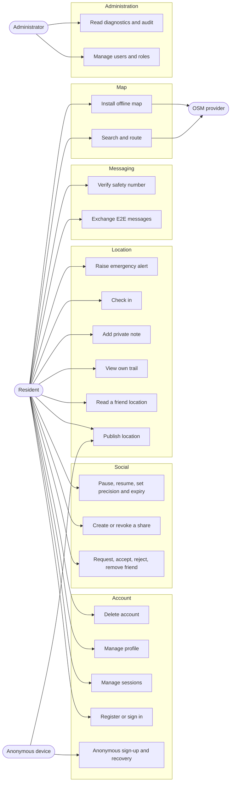
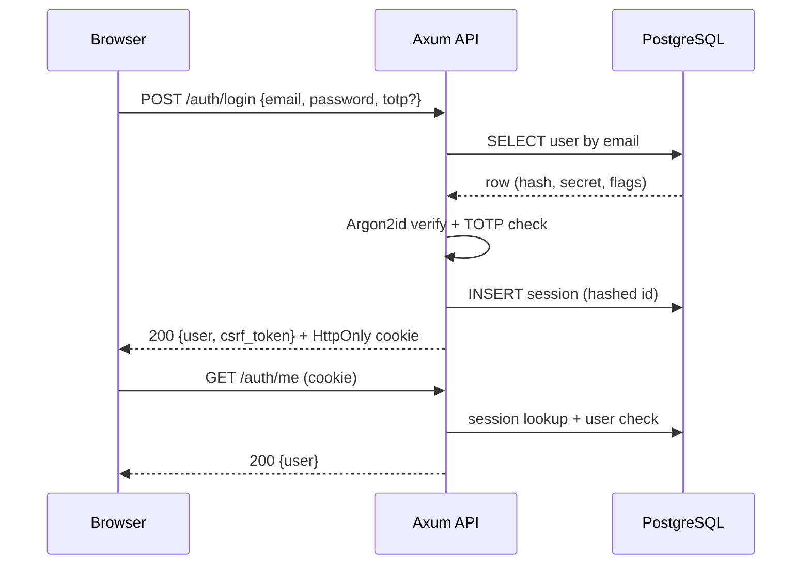
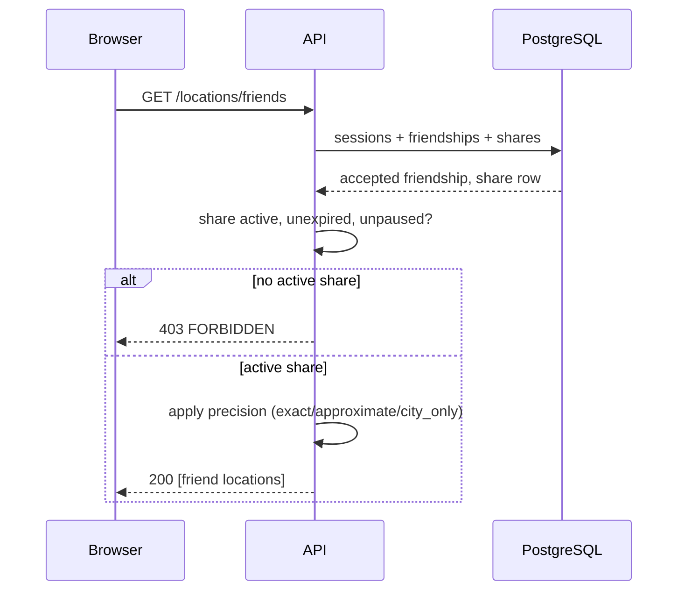
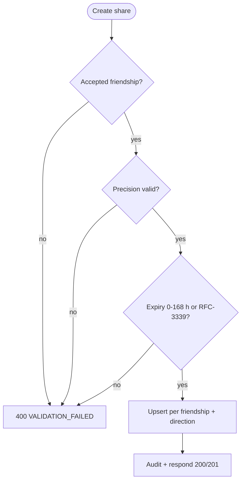
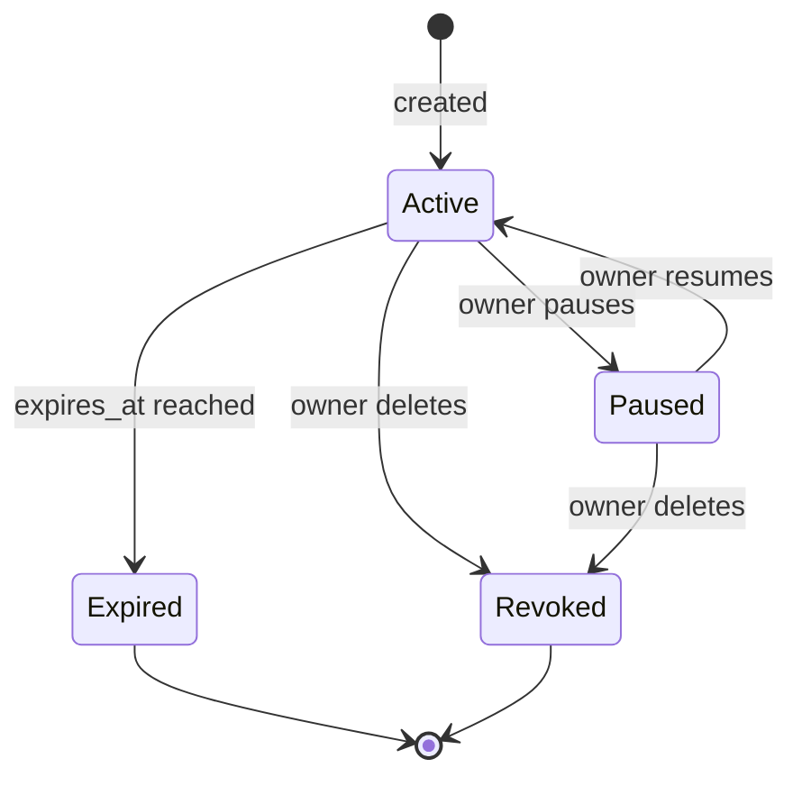
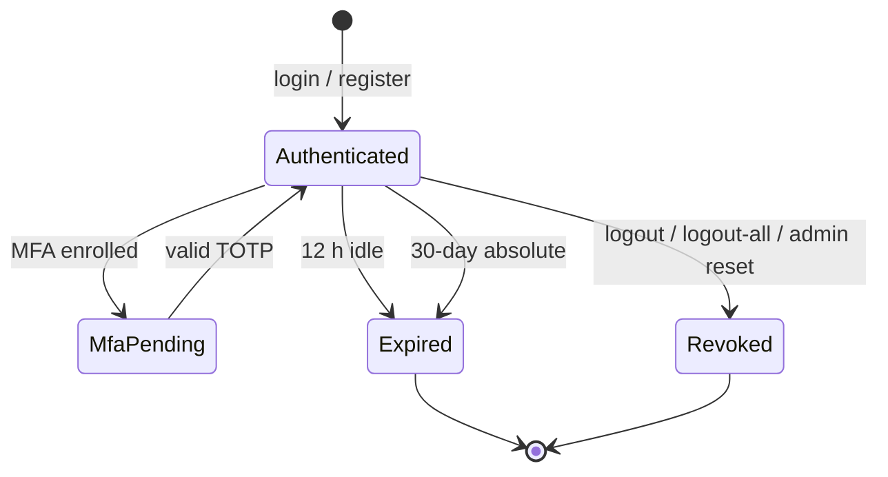
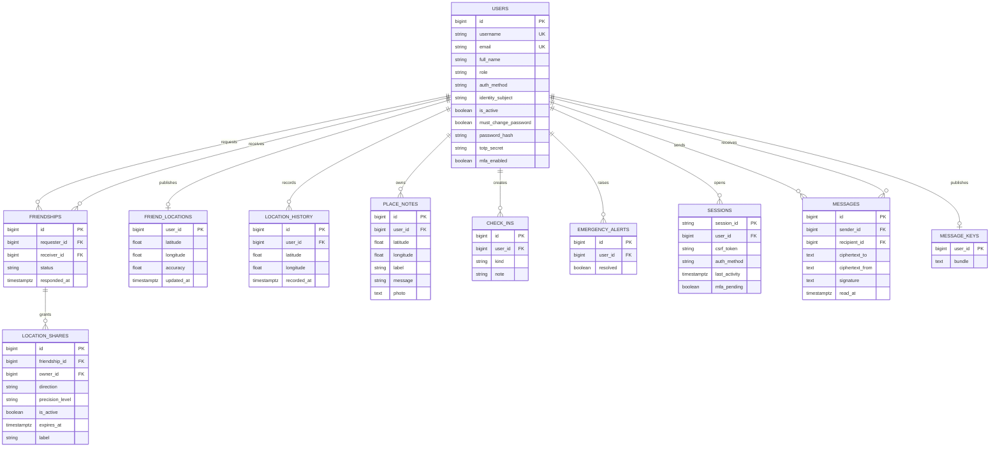
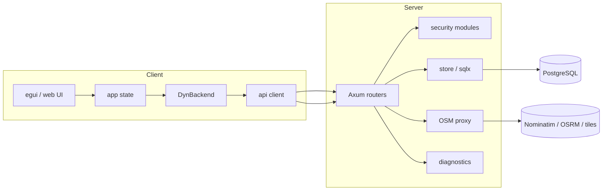
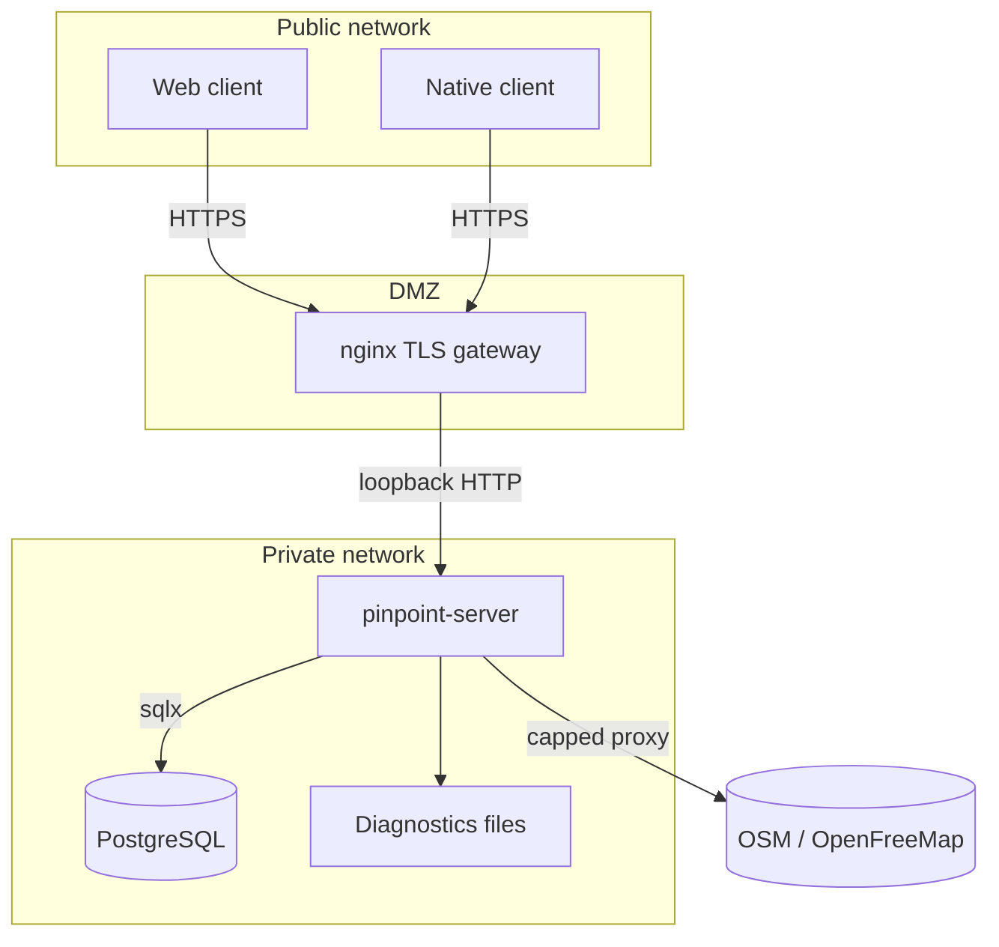

# System Models, Requirements and Use Cases

This page is the modelling evidence for Midterm 1: topic, subject, objectives,
functional and non-functional requirements, CIA requirements, the UML model
set, and the mapping from threats to use cases. Diagrams are Mermaid so they
render in the repository and can be pasted into the report.

## 1. Topic, subject and objectives

**Topic.** A client-server system for privacy-first, consent-based location
sharing between trusted contacts.

**Subject.** Design and development of a multi-platform client and an Axum
backend that let a person share their current location with individually
chosen friends, at a chosen precision and for a bounded time, revoke or pause
any share immediately, keep a private 24-hour trail and private place notes,
exchange end-to-end encrypted 1:1 messages, browse maps offline, and let an
administrator manage accounts and diagnostics. The target group is small
trusted circles (families, friends); the scope excludes public discovery,
advertising, trackers and server-side plaintext access to messages.

**Objectives.**

1. The system will let a person create an account, sign in with a second
   factor, and revoke any session.
2. The system will let a person publish a location and control, per friend,
   whether it is visible, at what precision, and until when.
3. The system will deny location access unless an active, unexpired,
   unpaused share names the requester as recipient.
4. The system will keep an owner-only trail, private notes and check-ins that
   no other account can read.
5. The system will deliver 1:1 messages whose plaintext exists only on the
   participants' devices.
6. The system will keep the map usable without a connection.
7. The system will record security-relevant actions so an administrator can
   investigate them.
8. The system will delete an account and its data on request.

## 2. Actors and use cases

Actors: **resident** (registered person), **anonymous device user**,
**administrator**, **OSM provider** (external service), **operator**
(deployment).

## 3. Requirements

### Functional

| ID | Requirement | Use case | Acceptance |
|---|---|---|---|
| F-01 | Register, sign in, optional TOTP, list and revoke sessions | UC-01, UC-03 | `tests/router_probe.rs`, `tests/auth_password.rs` |
| F-02 | Anonymous device account with a one-time recovery code; old code invalid after recovery | UC-02 | `tests/router_probe.rs` |
| F-03 | Friend request lifecycle; a rejected request needs a fresh one | UC-06 | `tests/router_probe.rs`, smoke check |
| F-04 | Per-friend directional share with precision, pause and expiry (24 h default, 168 h cap) | UC-07, UC-08 | `tests/location_consent.rs` |
| F-05 | Publish a location; reject invalid coordinates and implausible accuracy | UC-09 | `tests/location_consent.rs` |
| F-06 | Friend locations only under an active share, precision applied before serialization | UC-10 | `tests/location_consent.rs` |
| F-07 | Owner-only trail, notes, check-ins and bookmarks | UC-11, UC-12, UC-13 | `tests/today.rs`, `tests/account_delete.rs` |
| F-08 | Emergency alert publishes the location without overriding a paused share | UC-14 | `tests/location_consent.rs` |
| F-09 | E2E 1:1 messages, safety number, read receipts | UC-15, UC-16 | `tests/message-vector.json`, `web/app/test/message-js-vector.json` |
| F-10 | Map search, reverse geocode, routing through the proxy, ODbL attribution | UC-17 | `tests/map_route_e2e.rs`, `map-qa.yml` |
| F-11 | Offline pack install and use without a connection | UC-18 | `tests/map_offline_e2e.rs` |
| F-12 | Admin user management, forced rotation, diagnostics and audit | UC-19, UC-20 | `tests/router_probe.rs`, `tests/account_delete.rs` |
| F-13 | Account deletion erases profile, friendships, shares, locations, notes, messages | UC-05 | `tests/account_delete.rs` |

### Non-functional

| ID | Requirement | Evidence |
|---|---|---|
| N-01 | Security: server-side authorization on every request; no trust in the client | `docs/security-architecture.md`, `tests/` |
| N-02 | Privacy: no trackers, no third-party scripts, no IP geolocation, no plaintext messages on the server | `docs/PRIVACY.md`, ADR-0023 |
| N-03 | Performance: p95 API latency under 300 ms on the demo hardware for list and publish routes | not benchmarked; documented limitation |
| N-04 | Availability: offline map and offline-first client; single-primary Postgres with 5-minute dumps | `docs/DEPLOYMENT.md` |
| N-05 | Usability: keyboard-operable web UI, labelled inputs, live status regions | `web/app/test/*.mjs` |
| N-06 | Portability: desktop, Android and web from one Rust core; iOS unverified | ADR-0007, CI client builds |
| N-07 | Maintainability: one module per concern, contract tests, ADRs for decisions | `AGENTS.md`, `docs/adr/` |

### CIA

| ID | Requirement | Implementation |
|---|---|---|
| C-01 | Location, notes, trail and messages are readable only by their owner or an authorized recipient | Consent checks, precision downgrade, ciphertext-only messages |
| I-01 | Data cannot be altered by another account or by a tampered client | Server-side validation, Ed25519 message signatures, audit log |
| A-01 | The service resists abuse and remains usable | Per-client/per-account rate limits, offline maps, backups |

## 4. UML models

### 4.1 Sign-in sequence

### 4.2 Reading a friend location

### 4.3 Creating a share (activity)

### 4.4 Share and session state

### 4.5 Entity-relationship model

### 4.6 Component and deployment views

## 5. Threat-to-use-case mapping

| Use case | Threats | Primary countermeasure |
|---|---|---|
| UC-01 sign-in | T-03, T-05 | Argon2id, constant-time verification, throttles, cookie flags, CSRF |
| UC-06 friends | T-01, T-05 | Server-side participant checks, generic errors |
| UC-07/08 shares | T-01, T-02 | Directional share, precision, expiry, owner-only list |
| UC-09/10 locations | T-01, T-06 | Consent check on read, latest-only storage, precision downgrade |
| UC-11/12/13 private data | T-01, T-13 | Owner filter on every query; at-rest limitation recorded |
| UC-14 emergency | T-02 | Publishes the point but does not override a paused share |
| UC-15 messages | T-03, T-13 | E2E ciphertext, signatures, safety number |
| UC-17/18 map | T-07 | Proxy caps, attribution, client throttle |
| UC-19/20 admin | T-15, T-14 | Role checks, audit log, redaction |

## 6. Traceability

| Use case | Code | Test |
|---|---|---|
| UC-01..03 | `src/server/auth_handlers.rs`, `src/server/state/sessions.rs` | `tests/router_probe.rs`, `tests/auth_password.rs` |
| UC-06 | `src/server/users_handlers.rs` | `tests/router_probe.rs` |
| UC-07..10 | `src/server/locations_handlers.rs` | `tests/location_consent.rs` |
| UC-11..13 | `src/server/locations_handlers.rs` | `tests/today.rs` |
| UC-15..16 | `src/server/messages_handlers.rs`, `src/security/e2e.rs` | message vectors |
| UC-17..18 | `src/server/mod.rs`, `src/server/offline_handlers.rs`, `web/app/map.js` | `tests/map_route_e2e.rs`, `tests/map_offline_e2e.rs` |
| UC-19..20 | `src/server/admin_handlers.rs`, `src/server/diagnostic_handlers.rs` | `tests/router_probe.rs` |

## 7. Known modelling limits

- Mermaid approximates UML use-case and deployment notation; the report can
  redraw them in a UML tool without changing the content.
- Performance (N-03) is a target, not a measured result.
- iOS is modelled as a build target but is not verified in CI.
