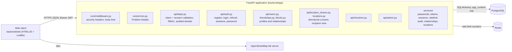

# 5. Building Block View

## 5.1 Whitebox Overall System

1. **User mobile apps:** Android and iPhone clients for profiles, statuses, map,
   location permissions, sharing controls, caches, chat, media, and notifications.
2. **Backend server and APIs:** authenticated entry point for mobile clients;
   validates requests, applies authorization, rate limits, and returns only data
   allowed by the viewer relationship.
3. **Identity service:** accounts, immutable user IDs, usernames, pseudonymous
   names, devices, sessions, recovery, and username cooldowns.
4. **Relationship service:** friends, consent, blocks, groups, membership, and
   profile visibility rules.
5. **Location service:** encrypted updates, expiry, coarse display, and access
   checks.
6. **Movement and discovery service:** opt-in trail storage, visited-region tiles,
   friend-mosaic composition, route/heading/speed analysis, uncertainty corridors,
   cache-area intersection, missing-person activation, recipient checks, and access
   logs.
7. **Content services:** caches, messaging, prompts, challenges, media, moderation,
   and reports.
8. **Optional services:** calls and future creative workloads isolated from private
   location data.
9. **Operations:** queues, notifications, audit events, monitoring, backups, and
   incident response.

See [Architecture Models](./architecture-models.md) for the high-level
technology/model choices underlying these building blocks, and
[Domain Data Model](../reference/domain-data-model.md) for the entity-level detail.

## 5.1a As built (September MVP)

The MVP is a modular monolith in `backend/`:

| Planned building block | MVP implementation |
|---|---|
| User mobile apps | Web client (`backend/web`); Flutter deferred ([ADR 0004](../adr/web-client-for-mvp-demonstration.md)) |
| Backend server and APIs | `backend/app` (FastAPI) |
| Identity service | `api/auth.py`, `services/{passwords,tokens,sessions}.py`, `models/{user,auth_session}.py` |
| Relationship service | `api/{friendships,blocks,users}.py`, `services/relationships.py` |
| Location service | `api/{location_shares,locations}.py`, `services/locations.py` |
| Operations | `services/{audit,ratelimit}.py`, `api/admin.py`, `app/cli.py` |
| Movement/discovery, content, optional services | Deferred |

## 5.2 Level 2: Component Breakdown

### Location service and movement/discovery service

The most safety-critical building blocks. See:
- [Location Sharing Lifecycle](./location-sharing-lifecycle.md)
- [Movement Trails and Search Corridors](./movement-trails-and-search-corridors.md)
- [Friend Mosaic Maps](./friend-mosaic-maps.md)
- [Cache and Permission Model](./cache-and-permission-model.md)

### Identity and relationship service

See [Actors and Accounts](../reference/actors-and-accounts.md) and
[Profile and Visibility Model](../reference/profile-and-visibility-model.md).

### Content services (messaging, prompts, challenges)

See [Social and Community Features](../explanation/social-and-community-features.md),
[Messaging and Group Lifecycle](./messaging-and-group-lifecycle.md),
[Daily Prompts and Media](../explanation/daily-prompts-and-media.md), and
[Friend Challenges and Group Prompts](../explanation/friend-challenges-and-group-prompts.md).

---
*Part of the [architecture documentation](./README.md) (arc42 §5, C4 Levels 2–3:
Container/Component). Keep this in sync with the actual code structure — update it
in the same PR that changes module boundaries.*
