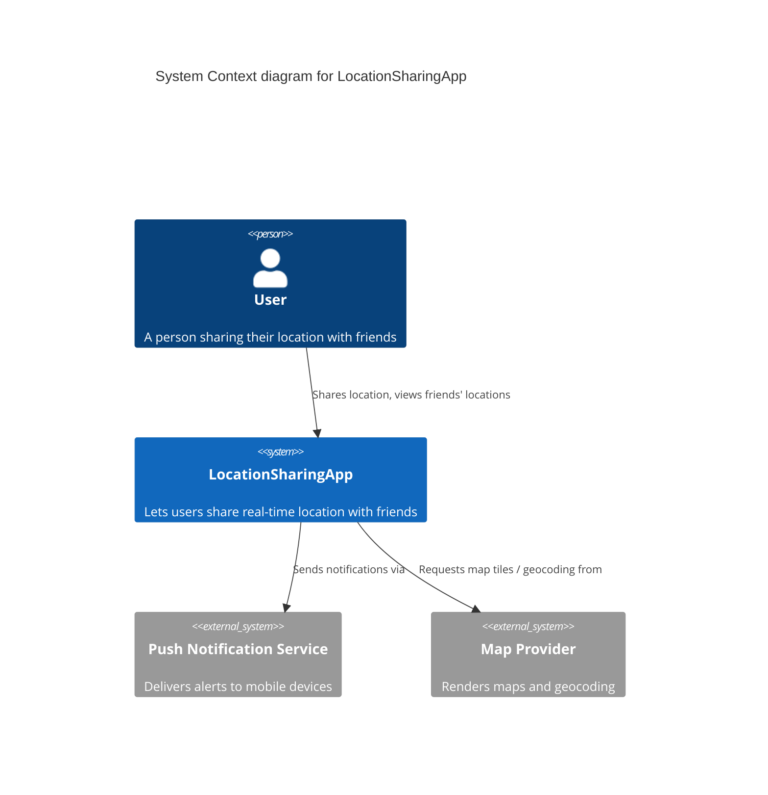

# Architecture Diagrams

Diagrams here follow the **C4 model** levels plus UML class/sequence views.
All are written as text (Mermaid) so they are diffable and reviewable in pull
requests, and never silently drift out of sync with the code.

## C4 Model Levels

| Level | File | Purpose | Status |
|-------|------|---------|--------|
| 1. Context | [`context-diagram.md`](./context-diagram.md) | System + external actors/systems ([§3](../context-and-scope.md)) | Implemented |
| 2. Container | [`container-diagram.md`](./container-diagram.md) | Deployable/runnable units ([§5](../building-block-view.md)) | Implemented |
| 3. Component | [`component-backend-api.md`](./component-backend-api.md) | Internals of the API service ([§5.2](../building-block-view.md)) | Implemented (matches `backend/app/`) |
| Deployment | [`deployment-diagram.md`](./deployment-diagram.md) | Physical/infra topology ([§7](../deployment-view.md)) | Implemented |

## UML Views

| View | File | Purpose |
|------|------|---------|
| Class diagram — domain | [`class-domain-model.md`](./class-domain-model.md) | Persistent entities, columns, constraints (`backend/app/models/`) |
| Class diagram — security | [`class-security-components.md`](./class-security-components.md) | Service-layer facades, policies, repositories (patterns applied) |
| Sequence — login | [`sequence-login.md`](./sequence-login.md) | Rate limit → lockout/anti-enumeration → session + JWT issuance |
| Sequence — authorized read | [`sequence-authorized-location-read.md`](./sequence-authorized-location-read.md) | The 9-step complete-mediation control sequence |
| Sequence — consent lifecycle | [`sequence-friendship-consent.md`](./sequence-friendship-consent.md) | Friendship → consent → read → revoke → block |

Runtime scenarios in prose live in [§6 Runtime View](../runtime-view.md);
the pattern catalogue that names each component is
[Design Patterns and Principles](../../reference/design-patterns.md).

## Getting Started

Use the example below as a starting template for a new *context* diagram:

## Adding Diagrams

- Keep this README's table up to date with the files that actually exist.
- A diagram that describes code must change in the **same PR** as the code
  (docs-as-code rule in [`CONTRIBUTING.md`](../../CONTRIBUTING.md)).
- Use Mermaid for sequence/structure diagrams; PlantUML only when Mermaid
  cannot express the view.
- Keep diagram titles descriptive and reference them from the architecture
  documents they illustrate.

**Tips:**
- Use Mermaid for sequence diagrams and simple structure diagrams
- Use PlantUML for complex component diagrams if needed
- Keep diagram titles descriptive
- Reference diagrams from the main architecture documents
