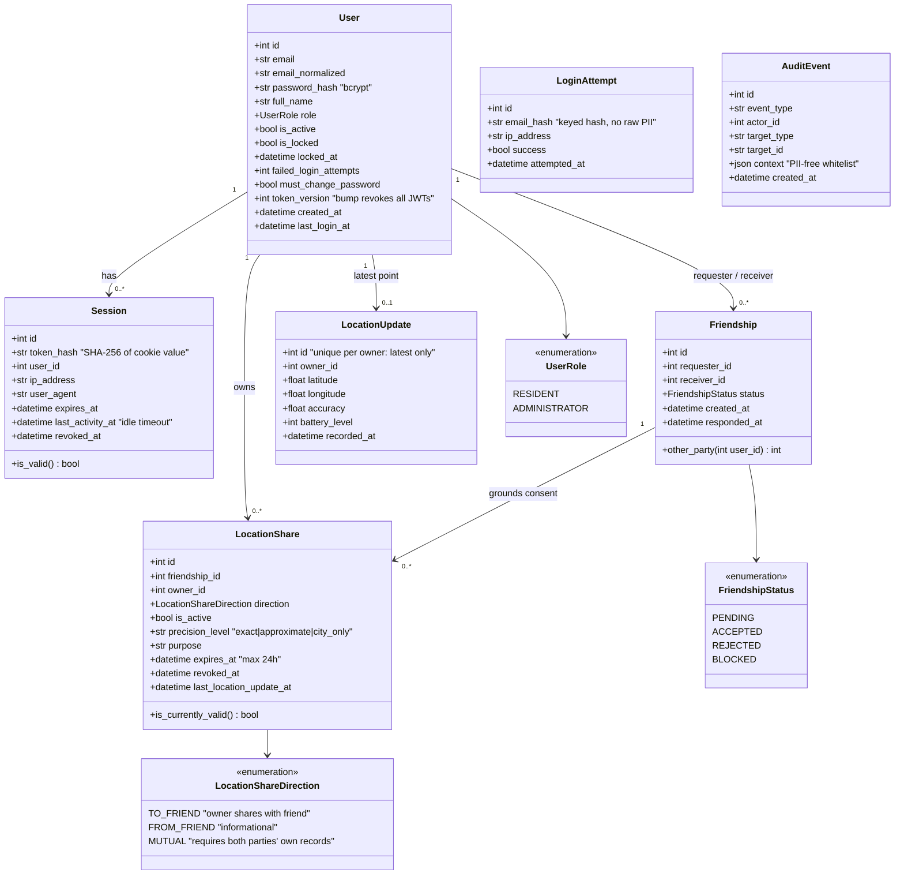

# UML Class Diagram — Domain Model

Persistent domain classes as implemented in
[`backend/app/models/`](../../backend/app/models). Maps to the entities in
[Domain Data Model](../../reference/domain-data-model.md) that the MVP
implements; security-relevant columns are annotated.

## Integrity constraints (enforced in the schema)

- `friendships`: `UNIQUE(requester_id, receiver_id)` and
  `CHECK(requester_id <> receiver_id)` — no duplicates, no self-friendship.
  Order-insensitive duplicate prevention (A→B vs B→A) is enforced in the
  service layer.
- `location_updates`: one row per owner (upsert) — **no location history is
  stored**; trails are a deferred, separately consented feature.
- `sessions.token_hash` and `login_attempts.email_hash`: plaintext secrets
  never reach the database.

## Service-layer classes

The non-persistent classes (facades, policies, repositories) are shown in
[Class Diagram — Security Components](./class-security-components.md).

---
*See [Design Patterns and Principles](../../reference/design-patterns.md)
for the rules these classes follow (layering, transactions).*
