# UML Class Diagram — Security Components

Service-layer structure of the implemented backend. Stereotypes map to the
[Design Patterns and Principles](../../reference/design-patterns.md)
catalogue. Source:
[`backend/app/services/`](../../backend/app/services),
[`backend/app/repositories/`](../../backend/app/repositories),
[`backend/app/api/deps.py`](../../backend/app/api/deps.py).

```mermaid
classDiagram
    class AuthService {
        <<Facade>>
        -UserRepository users
        -SessionRepository sessions
        -LoginAttemptRepository attempts
        -TokenService tokens
        -AuditLogger audit
        -PasswordPolicy policy
        +login(email, password, ip, user_agent) LoginResult
        +logout_by_session_token(token) bool
        +logout_by_session_id(id, actor_id) bool
        +change_password(user, current, new, keep_session_id)
        +force_change_password(user, new, keep_session_id)
        -_apply_password_change(user, new, keep_session_id) "Template Method"
    }

    class TokenService {
        <<Facade>>
        -str secret
        -str algorithm "allowlist: HS256"
        +create_access_token(user_id, session_id, ver) str
        +create_refresh_token(user_id, session_id, ver) str
        +decode(token, expected_type) TokenClaims
    }

    class TokenClaims {
        <<value object>>
        +int user_id
        +int session_id
        +int token_version
        +str token_type
        +str jti
    }

    class PasswordPolicy {
        <<Chain of Responsibility>>
        -list~PasswordRule~ rules
        +validate(password) list~str~
        +is_valid(password) bool
    }

    class PasswordRule {
        <<Strategy>>
        <<abstract>>
        +code* str
        +check(password) str
    }

    class LocationAccessPolicy {
        <<Strategy>>
        -RelationshipService relationships
        +check(viewer_id, owner_id, share, now) LocationAccessDecision
    }

    class LocationAccessDecision {
        <<value object>>
        +bool allowed
        +str precision_level
        +str reason
    }

    class RelationshipService {
        <<Strategy>>
        -FriendshipRepository friendships
        +resolve(viewer_id, target_id) Relationship
    }

    class ProfileVisibilityPolicy {
        <<Strategy>>
        +visible_profile(viewer_id, target, relationship) VisibleProfile
    }

    class PrecisionReducer {
        <<Strategy>>
        <<abstract>>
        +label* str
        +reduce(lat, lng) tuple
    }

    class RateLimiter {
        <<Protocol / Strategy>>
        +hit(key, limit, window) RateLimitResult
    }

    class InMemoryRateLimiter {
        per-process sliding window
    }

    class RedisRateLimiter {
        shared INCR+EXPIRE window
    }

    class AuditLogger {
        <<Subject / Observer>>
        -list~AuditHandler~ handlers
        +subscribe(handler)
        +record(event_type, actor_id, ...) AuditEventData
    }

    class AuditHandler {
        <<Protocol>>
        +handle(event)
    }

    class UserRepository {
        <<Repository>>
        +get_by_id(id) User
        +get_by_email_normalized(email) User
        +add(user) User
    }

    class SessionRepository {
        <<Repository>>
        +get_by_token_hash(hash) Session
        +revoke_by_token_hash(hash, when) bool
        +revoke_all_for_user(id, when, except_id) int
    }

    class FriendshipRepository {
        <<Repository>>
        +find_between(a, b) Friendship
        +friend_ids_for(user_id) list
    }

    class LocationShareRepository {
        <<Repository>>
        +get_active_between(owner, viewer) LocationShare
        +list_active_incoming_for(viewer) list
        +revoke(share, when)
        +revoke_between(a, b, when) int
    }

    AuthService --> TokenService
    AuthService --> PasswordPolicy
    AuthService --> AuditLogger
    AuthService --> UserRepository
    AuthService --> SessionRepository
    AuthService --> LoginAttemptRepository : pseudonymised attempts
    TokenClaims <.. TokenService : produces
    PasswordPolicy "1" --> "*" PasswordRule : chains
    LocationAccessPolicy --> RelationshipService
    LocationAccessPolicy --> LocationAccessDecision
    LocationAccessPolicy --> PrecisionReducer : "selects via registry"
    ProfileVisibilityPolicy --> RelationshipService
    RateLimiter <|.. InMemoryRateLimiter
    RateLimiter <|.. RedisRateLimiter
    AuditLogger "1" --> "*" AuditHandler : notifies
    AuthService --> LocationShareRepository : revoke on block/password change
```

## Reading the diagram

- **Facades** (`AuthService`, `TokenService`) are the only entry points routers
  use for authentication behaviour — no endpoint re-implements it.
- **Policies** are pure decision objects: no I/O except the repository they
  were given, which makes the complete-mediation rules unit-testable.
- **Repositories** share the request-scoped ORM session injected by
  `api/deps.py`; they never commit.

---
*Runtime behaviour: [Sequence — Login](./sequence-login.md) and
[Sequence — Authorized Location Read](./sequence-authorized-location-read.md).*
