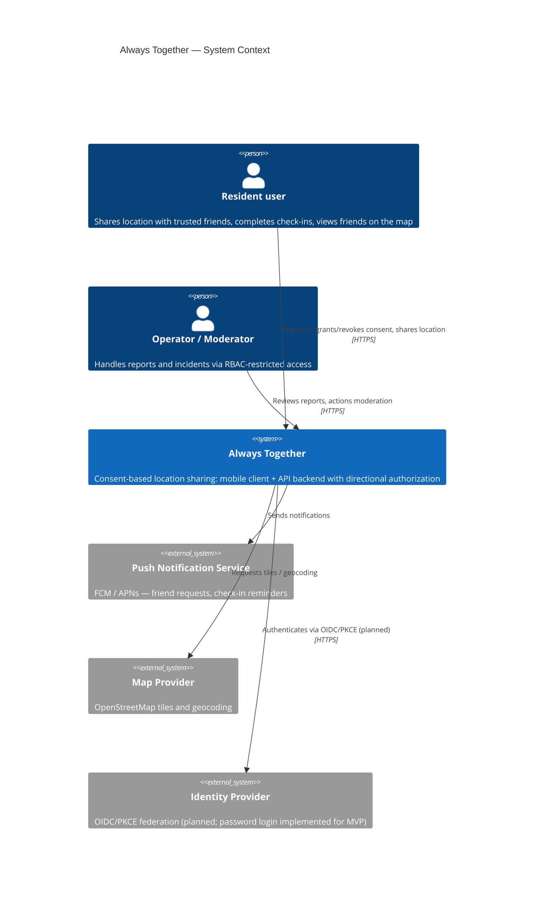

# System Context (C4 Level 1)

The system context of **Always Together** — a consent-based location-sharing
safety app. Corresponds to [§3 Context and Scope](../context-and-scope.md).

## Key properties

- **No public/anonymous consumers**: everything inside the system requires an
  authenticated principal (private by default, SC-03).
- The system never *pushes* precise location anywhere except to a viewer
  holding a valid, unexpired consent record (SC-02).
- External systems receive only what they need: map tiles requests carry no
  friendship data; navigation deep links carry a single coordinate pair.

---
*Next level: [Container View](./container-diagram.md).*
