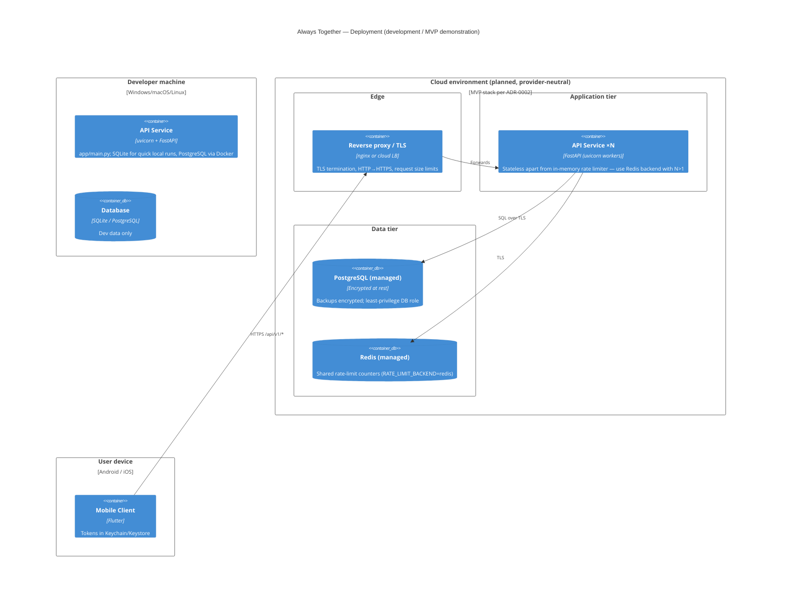

# Deployment View (C4 Deployment)

Physical/infra topology. The development topology is implemented and
documented here; the production topology reflects the frozen MVP stack in
[Technology Stack and Infrastructure](../../reference/technology-stack-and-infrastructure.md)
(hosting details remain risk **R1**). Corresponds to
[§7 Deployment View](../deployment-view.md).

## Deployment security notes

- **TLS everywhere**; the API sets HSTS on HTTPS responses and refuses
  non-allowlisted `Host` headers.
- **Secrets are environment configuration**: production refuses to start
  without a real `SECRET_KEY` (≥ 32 chars, placeholders rejected) — see
  [`backend/.env.example`](../../backend/.env.example).
- **Docs endpoints** (`/docs`, `/redoc`, `/openapi.json`) are disabled when
  `ENVIRONMENT=production`.
- **Multiple workers**: switch `RATE_LIMIT_BACKEND=redis`, otherwise each
  worker enforces its own budget (documented limitation).
- Database schema is currently created at startup (`create_all`); wiring
  Alembic migrations before production is tracked as technical debt.

---
*Part of the [architecture documentation](../README.md) (arc42 §7).*
