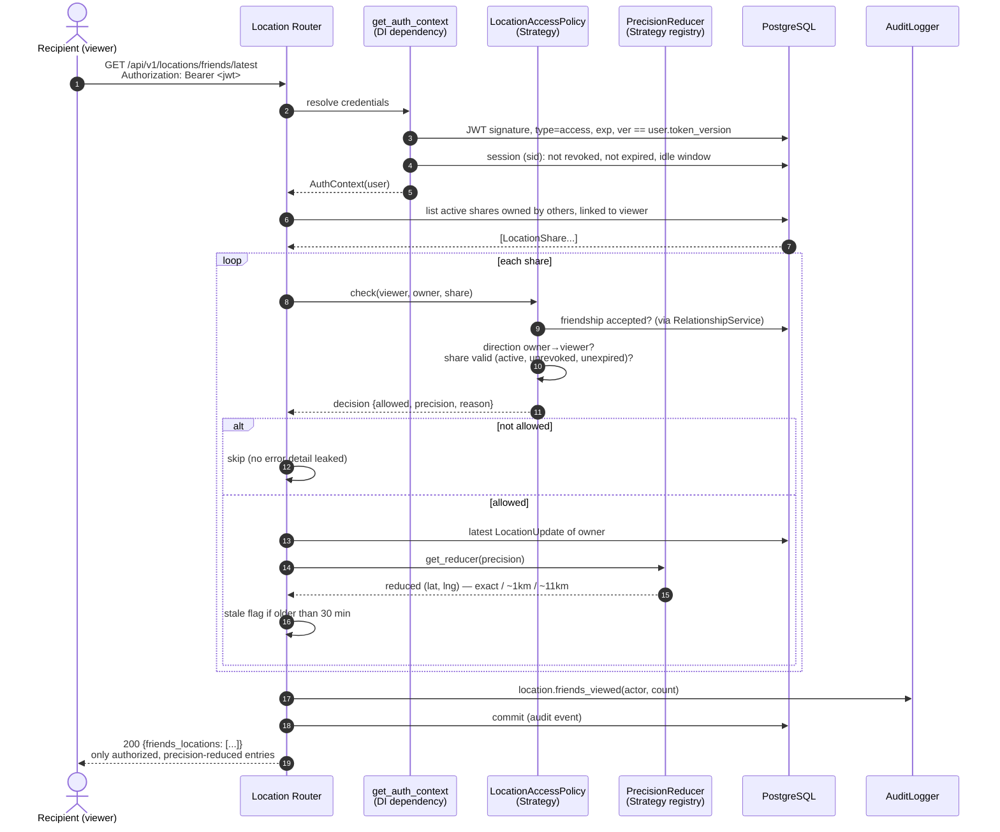

# Sequence — Authorized Location Read (complete mediation)

The canonical authorization scenario from
[§6.2 Control Sequence for a Location Read](../runtime-view.md), as
implemented by `GET /api/v1/locations/friends/latest` in
[`api/locations.py`](../../backend/app/api/locations.py) with
`LocationAccessPolicy` (SC-02, IDOR defence).

## Why each step matters

| Step | Control |
|---|---|
| 3-5 | One credential path for JWT and cookies; token versioning makes stolen JWTs die on password change |
| 8 | **Complete mediation**: the policy runs per friend — not once per request — so a revoked or expired share disappears immediately |
| 9-11 | Blocks and non-friendships deny silently; the caller cannot probe which friends had shares |
| 13 | Reduction happens **server-side** before the coordinate leaves the API; unknown precision fails closed to the coarsest reducer |
| 15 | One privacy-preserving audit event per list read (ids and counts only) |

Non-allowed reasons are recorded for forensics but never returned to the
caller (`no_active_share`, `share_expired`, `share_revoked`, `blocked`,
`direction_mismatch`).

---
*See [Privacy and Data Handling](../privacy-and-data-handling.md) and
[Security Control Register SC-02](../../reference/security-control-register.md#sc-02-directional-authorization).*
