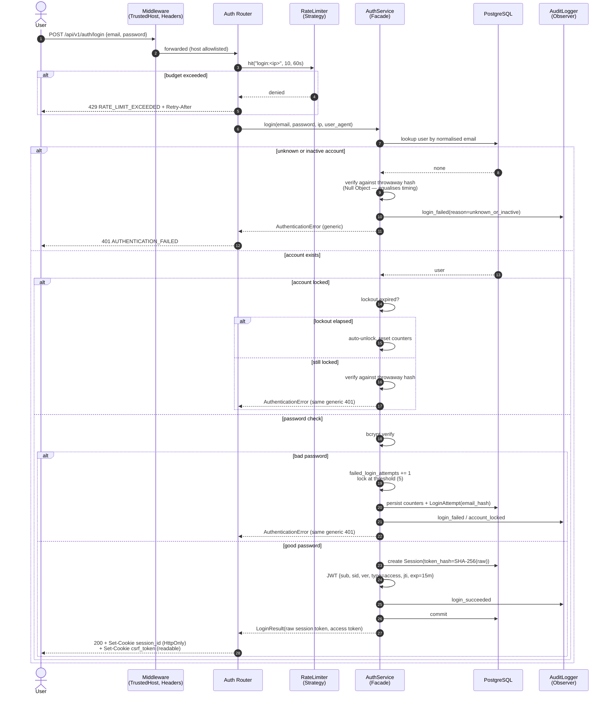

# Sequence — Login (with rate limiting, lockout, anti-enumeration)

Runtime behaviour of `POST /api/v1/auth/login` as implemented in
[`api/auth.py`](../../backend/app/api/auth.py) →
[`AuthService.login()`](../../backend/app/services/auth_service.py).
Patterns: Facade, Null Object (timing equalisation), Observer (audit).

## Design notes

- **Every failure is the same 401** (`AUTHENTICATION_FAILED`): account
  existence, lockout state, and password correctness are never disclosed.
- **Timing equalisation**: the bcrypt work happens for unknown accounts too,
  so response time cannot enumerate users (Null Object pattern).
- **Lockout auto-expires** (`LOCKOUT_DURATION_MINUTES`), unlike the previous
  implementation which locked accounts forever.
- **Session tokens are stored hashed**; the raw value exists only in the
  client's HttpOnly cookie.
- The access token is 15 minutes; the session is 3 hours absolute + 30
  minutes idle, checked on every authenticated request.

---
*See [Security Control Register SC-01](../../reference/security-control-register.md#sc-01-authentication).*
