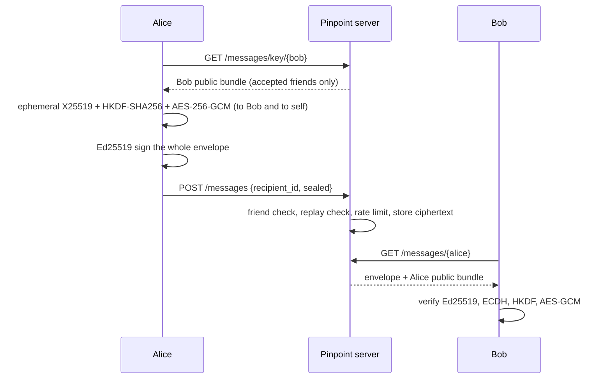

# End-to-end encrypted messages

Pinpoint has 1:1 text messages between accepted friends. The server stores
opaque envelopes and public keys; it never sees plaintext. This is an
ECIES-style construction over audited primitives, **not** the Signal Protocol.
The decision and its limits are in
[ADR-0023](./adr/0023-e2e-messages-ecies.md).

## Protocol

Each account has a long-lived X25519 key and an Ed25519 signing key. The
public halves are published once per signed-in session; the private halves stay
in the OS keychain (native) or as non-extractable WebCrypto `CryptoKey` objects
in IndexedDB (web).

- The recipient copy uses `HKDF(shared, salt_to, "pinpoint-message-v1-to")`;
  the sender's own copy uses a second key under `...-from`.
- The Ed25519 signature covers the version, both user ids, the ephemeral public
  key, both salts/nonces and both ciphertexts. A server cannot swap the
  ephemeral key and forge a message that verifies under the sender's key.
- The server enforces accepted-friends-only, a unique signature (no replay), a
  60 messages/minute per-user limit, fixed envelope sizes and ciphertext
  ceilings. It returns `409 NO_MESSAGE_KEY` until the friend has published a
  bundle.
- Read state is a server-side `read_at` timestamp on the recipient's copy. The
  sender sees "read" on their own thread. Read state is written only when the
  friend's copy actually changed, so open-thread polling does not rewrite rows.
  An open thread refreshes every five seconds on web and native, and the native
  More menu shows the unread count. Message times are rendered in the device's
  local time (native uses `format_message_time`; web uses `toLocaleString`), and
  the web Chats tab carries the unread count. A failed native send surfaces the
  error and puts the text back in the composer instead of dropping it.

## Storage

- Native: `message_identity_<user_id>` in the platform keychain; secrets never
  leave the device.
- Web: non-extractable `CryptoKey` objects in IndexedDB, keyed by user id.
  First use is a single readwrite transaction: two tabs opening at once
  converge on one stored identity instead of publishing two bundles.
- Server: `pinpoint_message_keys` (public bundle JSON) and
  `pinpoint_messages` (opaque envelope); migration 17. Account deletion removes
  the key and both message directions.

## Safety numbers

Both clients show the same **pair** safety number: SHA-256 over a domain
separator, both user ids and both public bundles, ordered by user id, first 16
bytes, colon-separated. Because the order is canonical, Alice and Bob see the
same string when they compare in person. The user can mark it **verified**:

- native stores the record under `message_verified_<user_id>` in the keychain;
- web stores it in `localStorage` per account and peer.

The record never leaves the device and is not a server claim. If the peer
publishes a different fingerprint, the state becomes **Changed**, the old
record is kept for comparison, and the user is asked to verify again. Deleting
the account removes the record with the message identity.

## Limits

- **One device per account for now.** Signing in on another device rotates the
  bundle; older messages stay on the old device. Multi-device fan-out is future
  work.
- **A peer key rotation invalidates old signatures.** Only the current public
  bundle is returned, so messages signed by the previous key can no longer be
  verified and show "Unable to decrypt" instead of being hidden. Retaining old
  bundles per message is future work.
- **No double ratchet.** A stolen long-lived private key can decrypt past
  messages; this is not Signal-grade forward secrecy.
- **Text only.** No groups, attachments, calls, push notifications, typing
  indicators or disappearing messages.
- **Metadata is visible to the server:** sender, recipient, timestamp and
  ciphertext size.
- **Not Signal-compatible.** There is no interop with Signal clients.

## Design patterns

The feature follows the existing seams rather than duplicating them:

- `server/state/messages.rs` is the repository/data-access layer over the
  in-memory `Store` and PostgreSQL; handlers never build SQL for the domain.
- The compose stack runs the same router as `pinpoint-messages` on 8007
  behind the gateway; a least-privilege `pinpoint_messages` role reads
  users/friendships and sessions but writes only the two message tables. The
  combined `pinpoint-server` binary mounts the same router for the demo.
- `server/messages_handlers.rs` is the service/controller layer: one place for
  friendship authorization, envelope validation and rate limiting.
- Native `PendingAction::{RefreshMessages, LoadMessageThread, SendMessage}` is
  the Command pattern; the five-second refresh is the Observer-style poll.
- `DynBackend` is dependency inversion/Strategy: the app talks to the trait,
  the REST adapter and failover wrapper are interchangeable.
- The standalone `src/patterns/` module remains a teaching/reference module.
  It is not forced into paths where the live architecture already has a
  simpler seam; patterns are a means, not a checklist.

## Tests

- `security::message_crypto`: recipient/self round-trip, wrong key, role swap,
  tampered ciphertext, forged signature, invalid text, fingerprint.
- `server::messages_handlers`: two real accounts, friendship authorization,
  send/list/decrypt, unread and read state, non-friend rejection, replay and
  malformed envelope rejection.
- Cross-language: `web/app/test/message-vector.json` (Rust seal -> JS open) and
  `web/app/test/message-js-vector.json` (JS seal -> Rust open).
- Browser: two isolated browser contexts register, become friends, exchange
  encrypted messages, see the safety number and read receipt.
- Safety numbers: `security::message_crypto::safety_number` is symmetric and
  pair-bound; `web/app/test/safety-vector.json` pins the Rust and JS outputs to
  the same string. The web E2E checks that Alice and Bob display the same
  number, then marks it verified, reloads, rotates the peer key (Changed) and
  verifies again. Native was checked on the x86 emulator: Mark as verified ->
  Verified, key rotation -> Changed with the warning, and the verified record
  survives an app restart. `models::trust_tests` covers the state transitions.
