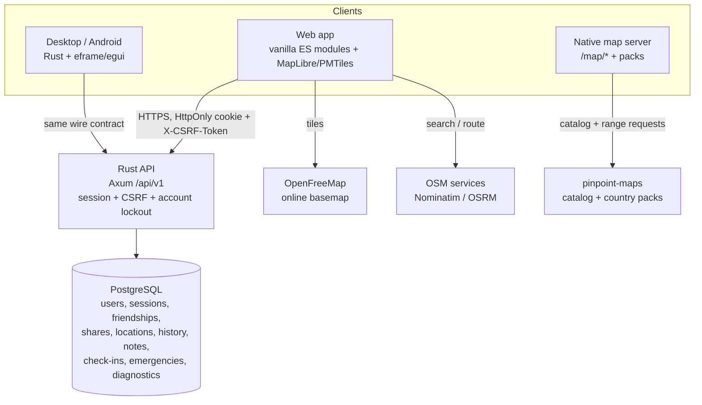
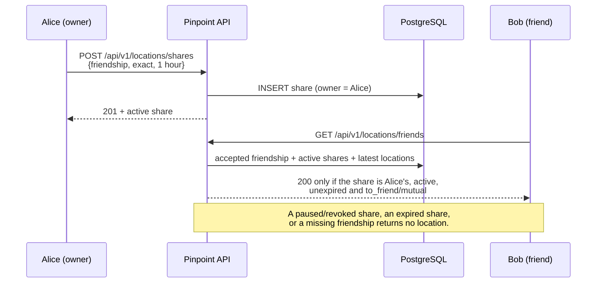

# Pinpoint - Midterm 2 Report

**Project:** Pinpoint - privacy-first location sharing for trusted friends  
**Version:** 2.6.1  
**Date:** 18 November 2026  
**Author:** [Your name]  
**Live system:** https://pinpoint-uj4y.onrender.com  
**Source:** https://github.com/Prince-of-Nothing/Pinpoint  
**Release:** https://github.com/Prince-of-Nothing/Pinpoint/releases/tag/v2.6.1

---

## Abstract

Pinpoint is a privacy-first location-sharing application for trusted friends.
Its defining rule is that **friendship is not consent**: a friendship grants no
location access until the owner creates an explicit, directional share with a
chosen precision and (optionally) an expiry. The server enforces every access
decision; the client is never trusted.

The project is implemented as one Rust core (API, desktop and Android clients)
plus a vanilla-ES-modules web client: three client surfaces. A Rust/Axum API
persists users, friendships, shares, the latest
location, a private 24-hour trail, private place notes, check-ins, emergencies
and diagnostics in PostgreSQL. Offline map packs are published from
`pinpoint-maps`; the Moldova pack ships in both clients, while Romania data is
published upstream but is not yet listed in either client catalog. The web
client installs the Moldova pack into OPFS and searches it without a network;
the native map server routes on the installed graph.

At Midterm 2 the delivered system is **v2.6.1**, deployed and verified live:
registration and sessions, friendships, consent-based sharing, pause/revoke,
exact/approximate/city-only precision, the private Today trail, private photo
notes, offline map/search, online search and routing, account deletion,
diagnostics, and a signed Android APK. No demo accounts and no seeded pins are
shipped; demo accounts are registered through the public flow.

The report covers the problem, the delivered scope, architecture, consent and
security model, data model, verification evidence, the demo, limitations and
the next steps. It is paired with a demo script and a slide deck in this
directory.

---

## 1. Problem and goals

Location sharing is useful for safety, but most products treat friendship as
permanent access. Three failures motivate Pinpoint:

1. **Friendship equals access.** Once two people are friends, one can watch the
   other indefinitely unless the other remembers to disable something.
2. **Stale data looks live.** A last-known dot is often shown without a clear
   freshness state, which is dangerous in an emergency.
3. **Control is incomplete.** Pausing, revoking, narrowing precision and
   understanding who can see you are buried or missing.

Goals:

- **Consent for every share.** A share is one-directional, explicit, and
  revocable; the owner chooses exact, approximate or city-only precision and an
  optional expiry.
- **Server-side enforcement.** Every read and write is authorized again on the
  server; a modified client cannot widen its access.
- **Honest state.** Expired, paused and revoked shares fail closed; check-ins
  and emergency alerts are owner-scoped.
- **Privacy by default.** No trackers, no third-party scripts, no IP
  geolocation, no real user data in tests, and map attribution is always
  visible.
- **Offline-first maps.** A country pack can be installed on-device, searched
  without a connection, and used for local routing on the native client.

## 2. Delivered scope (v2.6.1)

| Area | Delivered | Status |
|---|---|---|
| Identity | Email registration, login, optional TOTP, opaque sessions, sign-out, sign-out everywhere, password change, account deletion | Live |
| Friends | Request by exact handle, accept/reject, remove; handles are public, emails are not searchable by other residents | Live |
| Sharing consent | Explicit share sheet with named friend, precision, duration, a confirmation summary, and an active/paused/expired/revoked state | Live |
| Location | Publish manual or GPS coordinates; friend reads only through an active, unexpired, owner-created share | Live |
| Daily trail | A private 24-hour trail of the owner's published points, listed and drawn on the map; owner-only, pruned to 7 days on the next publish | Live |
| Private notes | Label + message + optional JPEG/PNG photo attached to a place; downscaled in the browser, server-enforced at about 675 KB decoded, owner-only | Live (web); text-only native |
| Map | OpenFreeMap online basemap, OSM search, OSRM driving directions, saved/recent places and routes | Live |
| Offline | Moldova native pack: 138.5 MB transfer / 204.0 MB installed; web OPFS pack: 220.3 MB (93.2 MB PMTiles + 6.8 MB search SQLite + 120.3 MB Valhalla); OPFS install, service-worker range serving, offline search. Romania data is published from `pinpoint-maps` but is not in either client catalog | Live web; native map server |
| Account | Active sessions with revoke, display name, diagnostics report, delete account | Live |
| Admin | Role-gated overview, users, diagnostics triage and append-only audit | Implemented; demo needs DB promotion |
| Clients | Web, desktop, Android APK (`arm64-v8a` + `armeabi-v7a`), native map server | v2.6.1 |

The native client's Today tab shows the trail and text notes. Photos remain
web-only because the native build has no image picker/decoder; the note list
labels a photo attachment and points to the web client.

## 3. Architecture



The API is a single Rust service (the binaries can also run split by service:
auth, users, locations, map, diagnostics, admin). PostgreSQL is authoritative;
the in-memory store is used by unit tests and local demo mode. HTML and static
responses are sent by handlers that apply the security headers, session
validation and CSP. JSON API responses currently do not carry the same header
set. During a request, handlers validate input, check authorization, and then
write the response.

### Request flow for a friend location read



## 4. Consent and security model

**Directional.** A share belongs to one owner and one friendship. Alice sharing
with Bob never implies Bob shares with Alice; `from_friend` rows are hidden from
"Who can see me".

**Precision.** `exact`, `approximate` (0.01 degree) and `city_only` (0.1
degree). The precision is applied **on read** by the server, and an unknown
precision is rejected rather than falling through to exact.

**Expiry and pause.** `expires_at` is checked on every read; a paused share is
inactive. The UI preserves the original expiry when pausing and never rewrites
precision on a pause.

**Ownership.** Only the owner can pause, resume, edit or delete a share. A
missing or foreign share returns the same not-found envelope.

**Private locations.** Check-ins and emergency alerts require authentication
and are owner-scoped; another user cannot list or delete them.

**Sessions.** Argon2id password hashes, opaque 256-bit server-side sessions,
`HttpOnly` + `SameSite=Lax` cookies, a CSRF token bound to the session and
echoed in `X-CSRF-Token` on every unsafe request. Sessions are revocable;
"sign out everywhere" and password changes invalidate them. Login locks an
account after five failures. The current build does **not** set the `Secure`
cookie flag even on HTTPS, has no `__Host-` prefix and no HSTS; there is no
per-IP server-side rate limit yet. These are known hardening gaps.

**Data minimization.** The server stores the latest location plus a bounded
history (24 hours visible; 7 days retained) and private notes. It does not
store continuous background tracking. The friend list, account data and trail
are never sent to Nominatim/OSRM/Overpass; a search sends only the query, and a
route sends only the endpoints being routed (which can be a friend's pin the
user chose to route to).

**Transport.** HTTPS off loopback; plain HTTP is only accepted for loopback
development (ADR-0006). The web client is same-origin, with a strict CSP,
`frame-ancestors 'none'`, no third-party scripts and no trackers. The CSP
allows inline styles (MapLibre) and `wasm-unsafe-eval` (SQLite); those are
documented relaxations. HSTS is not sent.

## 5. Data and persistence

Migration 16 adds `pinpoint_location_history` and `pinpoint_place_notes`.
Earlier migrations add users, sessions, friendships, shares, locations,
check-ins, emergencies, counters, the rollback snapshot, diagnostics and the
admin audit.

| Table | Purpose | Retention / access |
|---|---|---|
| `pinpoint_users` | Account, role, password hash, MFA fields | Until account deletion |
| `pinpoint_sessions` | Opaque session id, CSRF token, activity | Sliding idle expiry; revoked on logout |
| `pinpoint_friendships` | Requester/receiver/status | Until removed or account deletion |
| `pinpoint_shares` | Owner, friendship, direction, precision, expiry, active | Until revoked; expired rows fail closed |
| `pinpoint_locations` | Latest published location per user | Replaced on publish; deleted with account |
| `pinpoint_location_history` | Owner-only trail points | 7 days; 24 hours returned |
| `pinpoint_place_notes` | Private text/photo notes | Until the owner deletes them or the account |
| `pinpoint_checkins` / `pinpoint_emergencies` | Owner-scoped safety state | Owner-only; deleted with account |
| `pinpoint_diagnostic_reports` | User-initiated PII-free reports | Admin triage |
| `pinpoint_admin_audit` | Append-only admin actions | Read-only audit |

Direct writes are used for sessions, friendships, shares, the latest location,
the trail and notes. A whole-store snapshot still upserts users, check-ins and
emergencies, so a stale replica can revert a password, role or MFA change and
can resurrect a deleted check-in. This is a known multi-replica gap scheduled
before public use.

## 6. Verification and evidence

The project is verified at four levels.

### 6.1 Build and test gate

```
cargo fmt --all -- --check
cargo clippy --all-targets -- -D warnings
cargo build --locked
cargo test --locked
```

Latest result: **pass**. The library has **328 unit tests** and 24 test
binaries. Relevant suites:

| Suite | Result | What it pins |
|---|---|---|
| `tests/location_consent.rs` | 10 passed | friendship is not consent; exact precision; pause/revoke owner-only; expiry; invalid values; owner-scoped check-ins/emergencies |
| `tests/today.rs` | 2 passed | owner-only trail; owner-only notes; validation; unauthorised rejection |
| `tests/contract.rs` | 11 passed | auth envelope, CSRF header on unsafe methods, numeric IDs, new history/notes paths |
| `tests/assets.rs` | 11 passed | same-origin assets, CSP, service-worker cache rule, new UI wiring |
| `tests/router_probe.rs` | 17 passed | route table, health, auth gates, admin gates |
| `tests/account_delete.rs` | 1 passed | confirmation + password + cascade |
| `tests/auth_password.rs` | 1 passed | current-password requirement |

### 6.2 Live API checks

A manual two-account live run on the deployed service checked these flows
(14 assertions):

- email registration and login;
- friend request and accept;
- publishing two exact points;
- the owner's 24-hour trail (exact coordinates), and the trail is empty for the
  other user;
- private note create/list/delete, owner-only, with another user receiving
  `400`;
- exact share visibility to the friend;
- pause hides the location, resume restores it, revoke removes it;
- unauthenticated check-ins/emergencies return `401`;
- account deletion invalidates the session and login.

Latest live run on **v2.6.1**: **14/14 functional checks** passed (two email
accounts; trail, notes, exact share, pause/resume/revoke and account deletion).
This was a manual run; its transcript is not archived in the repository. The
functional assertions all passed; the separate version-string assertion in the
old script still expected `2.6.0`, while the server correctly reports `2.6.1`.
An earlier demo-hardening run on v2.5.2 passed **24/24** checks (also
unarchived).

### 6.3 Browser checks

- Live web UI: **9/9** manual assertions (empty-map prompt, online map,
  two-point trail, trail toggle, photo preview, note save + map marker, mobile
  no horizontal overflow); transcript not archived.
- Offline web: **7/7** manual assertions (Moldova install, offline reload,
  offline map, offline search); transcript not archived.
- Sharing UI unit checks: **17/17** (reproducible: `node web/app/test/sharing-ui.mjs`).

### 6.4 Artifact checks

- Release `v2.6.1`: `pinpoint-android-2.6.1.apk`, **13,632,525 B**,
  versionName `2.6.1`, versionCode `20601`, `arm64-v8a` + `armeabi-v7a`,
  signed with the Pinpoint release certificate (SHA-256
  `2b326ca140f5d34ac61672fb3a5ec2596ced91f9a2fd618d50b52fe89dea7e49`).
- Live `/health`: version `2.6.1`, PostgreSQL connected.
- CI: the v2.6.1 tag run fails only the dependency audit. The build, test,
  wasm, macOS and Windows jobs pass. The audit flags nine unmaintained or
  unsound transitive crates with no fixed upgrade; `audit.toml` now records
  them as accepted risk, and no known vulnerability is open.

## 7. Demo and presentation

- **Demo script:** [`Demo-Script.md`](./Demo-Script.md) - pre-flight, two
  browser profiles, exact run of show, expected values, fallbacks, phone
  install.
- **Presentation:** [`Presentation.md`](./Presentation.md) - 13-slide deck with
  speaker notes, timing and Q&A preparation.
- **Printable deck:** [`slides.html`](./slides.html) (open in a browser and
  print to PDF; A4 landscape).
- **Screenshots:** [`assets/`](./assets) - login, map, Today, notes, mobile,
  native theme, offline pack, offline route.

The 8-minute run is: sign in; online map + Chișinău -> Bălți route; consent
share with exact precision and 1 hour; friend sees exact coordinates; pause and
revoke; Today trail; private photo note; offline reload + search; native APK.
The demo uses **real accounts registered on the live system**, not seeded demo
rows.

## 8. Requirements traceability

| Requirement | Evidence |
|---|---|
| Register, login, logout, session control | `tests/contract.rs`, `tests/auth_password.rs`, live UI |
| Friends by handle; accept/reject/remove | `tests/router_probe.rs`, live UI, `tests/location_consent.rs` |
| Friendship alone grants no location | `tests/location_consent.rs::friend_locations_require_an_active_share` |
| Explicit, directional share with precision and expiry | `src/server/locations_handlers.rs`, `tests/location_consent.rs`, live UI |
| Pause/resume/revoke; owner-only | `tests/location_consent.rs`, live 14/14 on v2.6.1 |
| Exact coordinates are not rounded | `tests/location_consent.rs::exact_share_keeps_full_precision` |
| Private 24-hour trail | `tests/today.rs`, `docs/midterm2/assets/03-today-card.png` |
| Private text/photo notes | `tests/today.rs`, `assets/04-note-card.png` |
| Map, search, route | live OpenFreeMap/Nominatim/OSRM, `assets/map-clean.png`, `assets/08-route.png` |
| Offline pack, map and search | `assets/07-offline.png`, offline 7/7 |
| Account deletion and session revocation | `tests/account_delete.rs`, live erasure |
| Diagnostics and admin gates | `tests/router_probe.rs`, `src/server/admin_handlers.rs` |
| Security headers, CSP, same-origin assets (HTML/assets; API JSON headers pending) | `tests/assets.rs`, `src/server/web_handlers.rs` |

## 9. Limitations and risks

- **Admin console needs DB access.** There is no seeded admin and no HTTP
  bootstrap. An existing account must be promoted with
  `pinpoint-admin --promote-email <email>` and `DATABASE_URL`; until then the
  Admin tab is hidden.
- **MFA enrolment is not in the web UI.** The login form accepts TOTP, but
  enrolment is desktop/API only. There is no email password reset.
- **Offline web directions are unavailable.** The web client always calls
  `/map/route`; the offline pack supports map + search. The native map server
  routes on the installed graph.
- **Native photos are not implemented.** The web client supports photo notes;
  the native client sends text notes and labels attached photos.
- **No continuous background tracking.** The trail records explicit publishes,
  not a 24/7 GPS trace.
- **Anonymous accounts are not demo-safe on the multi-replica deployment.**
  Use email accounts.
- **Transport/cookie hardening is incomplete.** The live session cookie is
  `HttpOnly; SameSite=Lax` but not `Secure` and has no `__Host-` prefix; HSTS is
  absent. JSON API responses do not carry the security-header set that HTML and
  assets do. Fix before exposing real accounts.
- **Auth abuse limits are per account, not per IP.** Login locks after five
  failures, but register/anonymous signup have no server-side IP limit.
- **Dependency audit.** Nine transitive crates are unmaintained or carry a
  soundness warning with no fixed upgrade; `audit.toml` records them as
  accepted risk. No known vulnerability is open.
- **Scale.** The service is a modular monolith with a per-request convergence
  refresh; it is sized for a demonstration and small trusted groups, not a
  global consumer workload.

## 10. Next steps

1. Promote and verify the admin console with the deployment database; add a
   documented bootstrap path that does not require direct SQL.
2. Web MFA enrolment and account recovery by email.
3. Friend-visible notes with per-note consent, or explicit per-note sharing.
4. Offline web routing via a WASM router or a native bridge.
5. Mobile photo picker + image decoding.
6. Replace the per-request full refresh with targeted queries and a shared
   session/rate-limit cache; load-test the multi-replica path.
7. Fix the macOS installer test race and make all CI jobs deterministic.
8. Add a background-location design with explicit consent, retention and a
   visible indicator before claiming a "daily tracer" beyond explicit
   publishes.

---

## Appendix A - Primary endpoints

```
POST /api/v1/auth/register        POST /api/v1/auth/login
POST /api/v1/auth/logout          GET  /api/v1/auth/me
GET  /api/v1/auth/sessions        POST /api/v1/auth/logout-all
POST /api/v1/friendships/         GET  /api/v1/friendships/
POST /api/v1/friendships/:id/respond
POST /api/v1/locations/me         GET  /api/v1/locations/me
GET  /api/v1/locations/friends
GET  /api/v1/locations/history
GET/POST /api/v1/locations/notes  DELETE /api/v1/locations/notes/:id
GET/POST /api/v1/locations/shares PATCH/DELETE /api/v1/locations/shares/:id
GET/POST /api/v1/locations/check-ins
GET/POST /api/v1/locations/emergency
POST /api/v1/diagnostics/report
GET  /api/v1/admin/overview|users|diagnostics|audit
```

## Appendix B - Reproduce the gate

```bash
cargo fmt --all -- --check
cargo clippy --all-targets -- -D warnings
cargo build --locked
cargo test --locked
```

Live health:

```bash
curl https://pinpoint-uj4y.onrender.com/health
# {"database":"connected","mode":"postgres","status":"healthy","version":"2.6.1"}
```

---

*Prepared for Midterm 2. Screenshots are from the demo environment; the PNGs
carry no embedded version. The native screenshot is the v2.6.0 theme build.*
