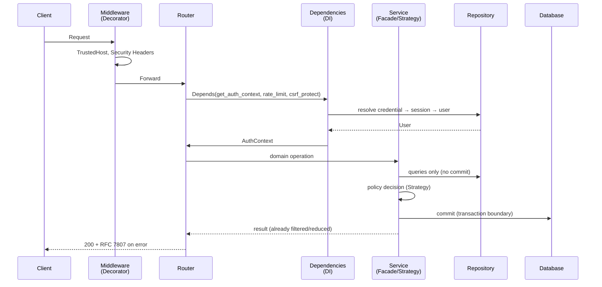

# Design Patterns and Principles (TMPS)

This reference catalogues the object-oriented design patterns and principles
("TMPS": SOLID plus the classic GoF pattern set) applied in the backend, and —
for each one — the security purpose it serves and the code that implements it.
It is the reviewable companion to [ADR-0003](../adr/0003-structure-backend-around-design-patterns.md).

Code lives under [`backend/app/`](../../backend/app). Every pattern entry links
to its implementation and its regression test.

## Why patterns here at all

In a safety-critical API, security behaviour that is scattered across routers
cannot be audited, tested, or replaced. Patterns give each control a **single
named home**; the [Security Control Register](./security-control-register.md)
then maps controls to those homes one-to-one.

## Pattern catalogue

| # | Pattern | Type | Where | Security purpose |
|---|---------|------|-------|------------------|
| 1 | Singleton | Creational | [`core/config.py`](../../backend/app/core/config.py) (`get_settings`), [`db/session.py`](../../backend/app/db/session.py) (engine/factory), [`services/token_service.py`](../../backend/app/services/token_service.py) (`get_token_service`), [`services/rate_limit.py`](../../backend/app/services/rate_limit.py) (`get_rate_limiter`) | One hardened configuration; no per-request re-parsing of secrets, one algorithm allowlist everywhere |
| 2 | Factory | Creational | [`main.py`](../../backend/app/main.py) (`create_application`), [`services/rate_limit.py`](../../backend/app/services/rate_limit.py) (backend selection), [`services/authorization.py`](../../backend/app/services/authorization.py) (`get_precision_reducer`) | Testable app instances; production rate-limit backend swapped without touching callers |
| 3 | Facade | Structural | [`services/auth_service.py`](../../backend/app/services/auth_service.py) (`AuthService`), [`services/token_service.py`](../../backend/app/services/token_service.py) (`TokenService`) | One reviewed path for login/logout/password change; no endpoint can authenticate "its own way" |
| 4 | Repository | Structural | [`repositories/people.py`](../../backend/app/repositories/people.py), [`repositories/locations.py`](../../backend/app/repositories/locations.py) | Queries centralised and parameterised (injection surface = one layer); services own transactions |
| 5 | Decorator (middleware) | Structural | [`middleware/security_headers.py`](../../backend/app/middleware/security_headers.py), CORS + TrustedHost in [`main.py`](../../backend/app/main.py) | Defence-in-depth headers (HSTS, CSP, nosniff) and host allowlisting on **every** response |
| 6 | Decorator-style dependencies | Structural | [`api/deps.py`](../../backend/app/api/deps.py) (`rate_limit()`, `csrf_protect`, `require_fresh_password`, `require_role`) | Cross-cutting gates compose onto endpoints declaratively; a new endpoint cannot forget them silently |
| 7 | Strategy | Behavioural | [`services/authorization.py`](../../backend/app/services/authorization.py) (`LocationAccessPolicy`, `ProfileVisibilityPolicy`, `RelationshipService`), [`services/password_policy.py`](../../backend/app/services/password_policy.py) (rules) | Visibility and consent decisions are swappable, individually tested algorithms — never inline `if`s |
| 8 | Registry + Open/Closed | Behavioural | [`services/authorization.py`](../../backend/app/services/authorization.py) (`PRECISION_REDUCERS`) | New precision levels are added without editing the access policy; unknown levels **fail closed** to the coarsest reducer |
| 9 | Chain of Responsibility | Behavioural | [`services/password_policy.py`](../../backend/app/services/password_policy.py) (`PasswordPolicy`) | Every rule runs and reports; a missing/unknown rule can never silently accept a password |
| 10 | Template Method | Behavioural | [`services/auth_service.py`](../../backend/app/services/auth_service.py) (`_apply_password_change`) | Self-service and forced password changes share one skeleton: policy → hash → token-version bump → session revocation → audit |
| 11 | Null Object | Behavioural | [`services/security.py`](../../backend/app/services/security.py) (`get_dummy_password_hash`) | Unknown-account logins still burn one bcrypt comparison — response timing cannot enumerate accounts |
| 12 | Observer | Behavioural | [`services/audit.py`](../../backend/app/services/audit.py) (`AuditLogger` + handlers) | Audit sinks (log, DB) attach without touching business code; a failing sink never breaks the flow |

## SOLID mapping

| Principle | How it shows up in this codebase |
|---|---|
| **S**ingle Responsibility | Each module owns one job: routers translate HTTP, services own decisions, repositories own queries, middleware owns headers. `security.py` holds only primitives; orchestration lives in `AuthService`. |
| **O**pen/Closed | Precision reducers and password rules extend via registration; adding a policy never edits existing routers. |
| **L**iskov Substitution | Any `RateLimiter` (memory/redis) or `PrecisionReducer` implementation is interchangeable; the protocol signatures are honoured exactly, and both rate-limiter backends are exercised. |
| **I**nterface Segregation | Narrow dependency providers (`get_user_repository`, `get_friendship_repository`, …) instead of one "god" session object; `RateLimiter` is a one-method protocol. |
| **D**ependency Inversion | Routers depend on repository/service abstractions injected by FastAPI, not on `SessionLocal`; tests swap implementations via `Depends` overrides. |

Supporting principles: **DRY** (one `get_auth_context()` for both credential
types), **Fail-safe defaults** (coarsest precision on unknown level, generic
401 on every credential failure, production refuses placeholder secrets),
**Least privilege** (viewer-filtered responses; owner-only revocation),
**Complete mediation** (every location read runs `LocationAccessPolicy`).

## Request lifecycle (patterns in action)

*Figure: one request, showing where each pattern applies. See
[Sequence: Authorized Location Read](../architecture/diagrams/sequence-authorized-location-read.md)
for the domain-level flow.*

## Layering rules (enforced by review)

1. Routers never query the ORM directly — only via repositories.
2. Services never import FastAPI types.
3. Repositories never `commit()` — the service owns the transaction.
4. `get_auth_context()` is the **only** place credentials are accepted.
5. Visibility decisions live in policies, never inline in endpoints.

## Known limitations (honest list)

- The in-memory rate limiter is per process; production must set
  `RATE_LIMIT_BACKEND=redis` (fallback is logged at boot).
- The common-password deny-list is small; replace with a breached-password
  corpus before release.
- bcrypt is pinned to 4.0.1 for passlib compatibility.
- Table creation uses `create_all` at startup; Alembic migrations are still
  to be wired (tracked in [Risks and Technical Debt](../architecture/risks-and-technical-debt.md)).

---
*See also: [Security Architecture and Data Protection](../architecture/security-architecture-and-data-protection.md),
[API Security Implementation](./api-security-implementation.md), and the
[Diagrams index](../architecture/diagrams/README.md).*
