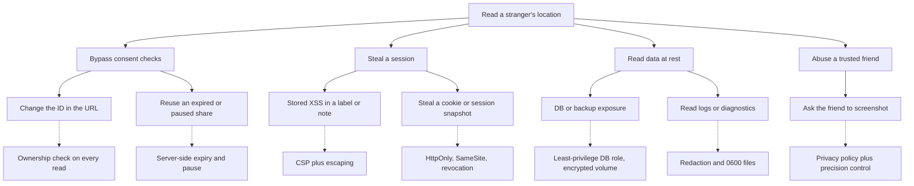

# Pinpoint — Security Architecture

**Status:** Implemented (Rust client, `src/security/` + Rust server in `src/server/`)  
**Audience:** Developers, reviewers, security auditors  
**Related:** [wiki SDLC-10 security and privacy](https://github.com/Prince-of-Nothing/Pinpoint/wiki/SDLC-10-Security-And-Privacy), [wiki Design Patterns](https://github.com/Prince-of-Nothing/Pinpoint/wiki/Design-Patterns), ADR-0006

This document describes every security measure in Pinpoint: what it protects,
how it works, where the code lives, and how it is tested. It also documents
threats, assumptions, and hardening guidance for deployment with friends and
beyond. It is written as a **long-form reference** — read it fully before
reviewing security changes.

---

## 1. Security Goals

1. **Consent is enforced server-side.** The client is untrusted. Every location read is authorized against friendship + share state on the Rust server.
2. **Fail closed.** On auth failure, missing cookie, or transport violation, the client denies and surfaces a clear error. It never claims success falsely (e.g., "logged out" when the server did not confirm).
3. **Plain HTTP only for loopback.** ADR-0006: `http://localhost`, `http://127.0.0.1`, `::1`, and Android emulator `10.0.2.2` may use plain HTTP for development. All other URLs require HTTPS.
4. **No real-data scraping.** Demo data is fictional (Chicago coordinates). Friend data is never sent to Nominatim/OSRM/Overpass.
5. **No trackers in the client.** No Firebase, FCM, analytics, or crash SDKs. `reqwest` + `serde` only for the portable core.
6. **Confidentiality at rest where feasible.** Bookmarks are owner-only JSON (`0600` on Unix); AES-256-GCM bookmark primitives exist but are not wired by default. Session keys are zeroized on drop.
7. **Accountability.** Security-relevant actions are audit-logged.
8. **Abuse resistance.** Client-side rate limiting + server-side rate limits; HMAC signing available for sensitive calls.

---

## 2. Threat Model

### 2.1 Method and scope

Assets: account identity (email, password hash, TOTP secret), session material,
current location, the owner-only 7-day trail, directional shares, private notes
and photos, bookmarks, E2E message plaintext (client-only), audit records and
the OSM provider quotas.

Trust boundaries:

- browser or native app ↔ API over TLS (`__Host-` cookie, CSRF header);
- API ↔ PostgreSQL (DSN, least-privilege role per service);
- gateway ↔ OSM providers (Nominatim, OSRM, tiles) with a privacy envelope;
- app ↔ device storage (bookmarks, E2E key, session snapshot).

Threats were identified per component with STRIDE and scored with a
DREAD-style impact × likelihood model, `R = I × L`, both on a 1–5 scale.
Priority bands: **Critical** `R ≥ 15`, **High** `9 ≤ R < 15`, **Medium**
`4 ≤ R < 9`, **Low** `R < 4`. The table is ordered by `R`; residual risk is
what remains after the listed countermeasure.

### 2.2 Prioritised threats

| ID | STRIDE | Component | Threat / abuse | Impact | Likelihood | R | Priority | Countermeasure | Residual risk |
|---|---|---|---|---|---|---|---|---|---|
| T-02 | Information disclosure | API, shares | Stalking via a forgotten or over-broad grant | 5 | 3 | 15 | Critical | Directional shares, precision control (`city_only`/`approximate`), pause/resume, expiry, owner-only list | User error (deliberate over-sharing) |
| T-01 | Elevation of privilege | API | IDOR: read another user's location by ID | 4 | 3 | 12 | High | Server-side ownership/consent check on every read; generic 403/404; audit event | A compromised client still relies on the server |
| T-06 | Information disclosure | API, Postgres | Location over-collection | 4 | 3 | 12 | High | Latest publish + owner-only 7-day trail pruned hourly; precision downgrade before serialization | A DB breach exposes the current point and the owner trail |
| T-07 | Denial of service | Map proxy, OSM | Scraping or bulk use of OSM services | 3 | 4 | 12 | High | Client 1 req/s Nominatim throttle; server caps (tiles 1200/min, search/reverse 60/min, route 120/min); gateway overwrites `X-Forwarded-For` | Public quota exhaustion under a botnet |
| T-11 | Tampering | Web client | Stored/reflected XSS reorders UI or steals a session | 4 | 3 | 12 | High | Server CSP, no third-party scripts, `textContent`/`escapeHtml` for user text, validated labels/notes | A new sink added without escaping |
| T-13 | Information disclosure | Postgres, backups | At-rest exposure of notes, photos, location rows | 4 | 3 | 12 | High | Note label/message/photo are AES-256-GCM encrypted with `DATA_ENCRYPTION_KEY` before storage; E2E messages are ciphertext; passwords are Argon2id | `pg_dump` backups are plaintext unless the encrypted wrapper is used; location rows remain unencrypted |
| T-03 | Spoofing | Session layer | Session hijack or cookie theft | 5 | 2 | 10 | High | `__Host-` cookie, `HttpOnly`, `SameSite=Lax`, `Secure` in production, 12 h sliding / 30-day absolute expiry, per-request DB validation, revocation | XSS in a client or a compromised device |
| T-10 | Tampering | API, DB | Injection through malformed input | 5 | 2 | 10 | High | Strict server validation, sqlx bound parameters only, no string-concatenated SQL, stable 400 envelope | Dependency zero-day (mitigated by `cargo audit`) |
| T-12 | Tampering | Build, dependencies | Compromised crate or toolchain | 5 | 2 | 10 | High | `Cargo.lock` committed, `cargo audit` gate with an explicit advisory allowlist, pinned patched `cookie` | A malicious maintainer or a new unpublished advisory |
| T-16 | Spoofing | OAuth | A provider identity takes over a password account | 5 | 2 | 10 | High | Identity bound to the provider subject, verified email required, an existing password email is refused (no auto-link) | A compromised provider account used as the only login |
| T-05 | Spoofing | Auth | Account enumeration or credential stuffing | 3 | 3 | 9 | High | Generic errors, constant-time verification for unknown emails, per-client HMAC throttles, per-account lockout | Credential reuse outside Pinpoint |
| T-04 | Tampering | API | CSRF on a state-changing request | 4 | 2 | 8 | Medium | Double-submit cookie + `X-CSRF-Token` on every unsafe method; 403 `CSRF_FAILED` | Token theft via XSS (same as T-03) |
| T-09 | Tampering | Transport | Payload tampering in transit | 4 | 2 | 8 | Medium | HTTPS-only client policy (ADR-0006), TLS gateway, HSTS, secure cookies | A compromised CA or client |
| T-14 | Information disclosure | Logs, diagnostics | Secrets or coordinates leak into logs | 4 | 2 | 8 | Medium | Redaction tests (`crash.rs`), envelope-only errors, no raw IP storage (HMAC keys), 0600/0700 diagnostics files on Unix | Panic messages from a future code path |
| T-08 | Information disclosure | Device storage | Bookmark theft on a stolen device | 3 | 2 | 6 | Medium | Owner-only `0600` file on Unix, `0700` app-data directory, OS account isolation | Disk theft or a compromised OS account; AES-GCM bookmark primitives not wired by default |
| T-15 | Elevation of privilege | API, admin | Privilege escalation through admin routes | 5 | 1 | 5 | Medium | Server-side role checks (`admin`/`administrator`), admin actions audited, role changes forbidden on self | A bug in a new admin route |

### 2.3 Attack tree for the top threat



### 2.4 Out of scope

- physical device seizure with an unlocked app (the optional PIN lock reduces
  but does not remove this);
- a malicious database administrator (the DB stores ciphertext for messages
  only);
- a compromised identity-provider account when OAuth is the only way the person signs in (the identity is bound to the provider subject, never to an email);
- network-level denial of service before the gateway.


---

## 3. Transport Security (ADR-0006)

### Rule

- `https://` — Accepted anywhere.
- `http://` — Accepted **only** for loopback hosts: `localhost`, `127.0.0.1`, `::1` (case-insensitive).
- All other schemes/hosts — **Rejected** with a clear error: `refusing plain HTTP to non-loopback backend`.

### Enforcement (`src/api.rs::validate_backend_url`)

```rust
match url.scheme() {
    "https" => Ok(url),
    "http" => {
        let loopback = match url.host() { ... };
        if loopback { Ok(url) } else { Err(...) }
    }
    other => Err(anyhow!("unsupported backend URL scheme ...")),
}
```

### Rationale

Developers must be able to run `http://localhost:8000` locally, but production must never use plaintext HTTP off-loopback. Fail-closed prevents accidental credential/location leakage over plaintext.

### Tests

```text
api::tests::accepts_loopback_http_development_urls ... ok
api::tests::accepts_https_everywhere ... ok
api::tests::rejects_plaintext_http_to_non_loopback_hosts ... ok
api::tests::rejects_unsupported_schemes_and_garbage ... ok
```

`rejects_plaintext_http_to_non_loopback_hosts` covers `example.com`, `api.example.com:8000`, `192.168.1.10:8000`, `10.0.2.2:8000` — note that Android emulator `10.0.2.2` is **rejected** by the Rust client for production URLs (it is only valid as the Android backend default for local dev where server CI decides). The client defaults to `http://localhost:8000` (or `http://10.0.2.2:8000` on Android) and the operator must override with HTTPS in production.

---

## 4. Authentication

### 4.1 Login / Register Flow

1. Client validates input (email, password, name) via `security::validation`.
2. Client rate-limits login attempts (`api_login`: 5/min).
3. `POST /api/v1/auth/login` with JSON `{email, password}`.
4. Server responds with `{access_token, csrf_token, user}` + `Set-Cookie: __Host-pinpoint_session=...` (loopback HTTP uses `session_id`).
5. Client stores the session cookie and CSRF token; sets `PinpointApp::set_offline_mode(false)`.
6. Client audits `auth/login success` (or `failure`).

### 4.2 Session Cookie

- **Name:** `__Host-pinpoint_session` over HTTPS; `session_id` on loopback HTTP where `Secure` is unavailable.
- **Flags:** HttpOnly, SameSite=Lax, Secure in production, Path=/, no Domain. The `__Host-` prefix prevents a sibling subdomain from overwriting the cookie.
- **Storage:** `ApiClient` keeps `cookies: Vec<String>` in memory (`Arc<Mutex<Option<Session>>>`); the cookie value is never logged.
- **Rotation:** Server re-issues cookies on every authenticated response; client updates from `Set-Cookie` headers.

### 4.3 CSRF Double-Submit

- Login/register returns `csrf_token` in the body **or** `X-CSRF-Token` response header.
- Client sends `X-CSRF-Token: <token>` on every unsafe method (`POST`/`PUT`/`PATCH`/`DELETE`).
- GET requests never send CSRF (safe methods).

Tests pin this behavior:

```text
login_parses_user_and_stores_session_material ... ok
unsafe_requests_send_csrf_double_submit ... ok
csrf_falls_back_to_response_header_when_body_omits_it ... ok
```

### 4.4 Fail-Closed Login/Logout

- **Rejected login:** `session_active()` stays `false`; the next request sends no `Cookie` and no `X-CSRF-Token`.
- **Login 200 without cookie:** Client errors `server accepted the credentials but issued no session cookie`.
- **Logout failure:** Server error keeps the session; client surfaces `Logout failed: ...`.
- **Confirmed logout:** Local session cleared; next request is anonymous.

Tests:

```text
rejected_login_leaves_client_unauthenticated ... ok
login_without_session_cookie_fails_closed ... ok
logout_failure_keeps_session_fail_closed ... ok
confirmed_logout_clears_session ... ok
```

### 4.5 Session Timeout (Client-Side `security/session.rs`)

`SessionManager` enforces locally:

- **Max lifetime:** 24 hours by default (`86400s`).
- **Idle timeout:** 30 minutes by default (`1800s`).
- **Reauth after:** Optional (unset by default).
- `is_authenticated()` returns `false` if expired, even if `state == Authenticated`.
- `record_activity()` refreshes `last_activity` or expires the session.
- `time_until_idle_timeout()` / `time_until_max_lifetime()` for UI countdowns.

Tests (2s idle timeout in `custom_config`):

```text
security::session::tests::create_and_validate_session ... ok
security::session::tests::session_timeout_on_activity ... ok
security::session::tests::terminate_session ... ok
security::session::tests::remaining_idle_time ... ok
security::session::tests::custom_config ... ok
```

Server-side timeouts (Rust `src/server/state/sessions.rs`) are authoritative; client timeout is UX hardening.

### 4.6 OAuth 2.0 Sign-In (Optional, ADR-0024)

Google OIDC and GitHub OAuth, authorization code + PKCE (S256), enabled only when
`PINPOINT_OAUTH_GOOGLE_CLIENT_ID`/`_SECRET` or
`PINPOINT_OAUTH_GITHUB_CLIENT_ID`/`_SECRET` are set. GitHub has no verified
email in `/user`, so the callback reads `/user/emails` and accepts only the
primary verified address:

1. `GET /auth/oauth/google/start` stores a pending state with its PKCE
   verifier for ten minutes, sets a short-lived `HttpOnly` `SameSite=Lax`
   state cookie scoped to `/api/v1/auth/oauth`, and redirects to Google.
2. The callback requires the state cookie to match the query state, consumes
   the state once, and exchanges the code server-side. The client secret and
   the verifier never reach the browser.
3. A verified email is mandatory. The identity is stored as
   `identity_subject = "google:<sub>"`; if the email already has a password
   account the callback refuses (`email_exists`) instead of linking, so a
   provider email change cannot become an account takeover.
4. Success creates the normal opaque session cookie, with the same CSRF,
   expiry and revocation behavior as password sign-in.
5. `/auth/oauth/*` is covered by the anonymous per-client throttle; pending
   states are in memory and fail closed on another replica.

Tests (`tests/oauth.rs`) run the full exchange against a local mock provider:
new account and session, repeat sign-in reuses the account, an existing
password email is refused, an unverified email is refused, and a foreign or
replayed state is refused.

---

## 5. Input Validation (`security/validation.rs`)

All user inputs are validated before any network call:

| Field | Rules |
|---|---|
| Email | Required, ≤254 chars, contains exactly one `@`, domain contains `.`, no null/newline. |
| Password | 8–128 chars, no null/control chars. |
| Name | Required, ≤100 chars, no null/newline. |
| Latitude | -90 to 90, finite. |
| Longitude | -180 to 180, finite. |
| Accuracy | ≥0, finite, ≤10,000,000 m, or `None`. |
| Search query | Required, ≤200 chars, no null bytes. |

`validate_location(lat, lon, accuracy)` combines checks with `ValidationResult::and()` (error accumulation: all errors are reported, not just the first).

**Client enforcement:** `PinpointApp::login/register/send_friend_request/publish_location` call validators first and set `set_error()` on failure without making a network request.

**Tests:** `security::validation::tests::{valid_email, invalid_email, valid_password, invalid_password, valid_latitude, invalid_latitude, valid_longitude, invalid_longitude, combined_location_validation, search_query_validation, name_validation}` — all pass.

---

## 6. Rate Limiting (`security/rate_limit.rs`)

### Client-Side `RateLimiter`

```rust
pub struct RateLimiter {
    configs: HashMap<&'static str, RateLimitConfig>,
    windows: Mutex<HashMap<String, RequestWindow>>,
}
```

| Endpoint key | `max_requests` | `window_seconds` | Purpose |
|---|---|---|---|
| `nominatim` | 1 | 1 | OSMF Nominatim policy |
| `osrm` | 2 | 1 | OSRM demo server courtesy |
| `overpass` | 1 | 5 | Overpass courtesy |
| `api_login` | 5 | 60 | Brute-force mitigation |
| `api_general` | 60 | 60 | General API abuse prevention |

`check()` returns `Allowed { remaining }` or `RateLimited { retry_after }`. `remaining()` peeks without consuming a slot. `retry_after()` reports the earliest slot-free instant.

**App wiring:** `PinpointApp::login()` checks `api_login`; `publish_location()` checks `api_general`; UI search checks `nominatim` in `spawn_action(SearchPlaces)`.

**Server-side:** the Rust server applies stricter per-client throttles (login 30 per 5 min, register 10/h, anonymous/recovery 20 per 10 min, diagnostics 10/h) and per-account write limits (120/min). Client limits are defense-in-depth, not a substitute.

### Tests

```text
allows_requests_within_limit
rejects_requests_over_limit
separate_endpoints_have_separate_limits
remaining_count_decreases          (fixed 2026-11-08: remaining = max.saturating_sub(used))
rate_limited_reports_retry_after
```

---

## 7. Encryption at Rest (`security/encryption.rs`)

### Goals

- Protect private data at rest (server notes/photos, on-device bookmarks) from
  disk theft, backup snooping, and casual inspection.
- Zeroize keys from memory on drop.
- Support key rotation.

### Design

- **Cipher:** AES-256-GCM via `aes-gcm` 0.11 (`Aes256Gcm`).
- **Nonce:** 12 bytes from `rand::thread_rng().fill_bytes()` (random, never reused with the same key).
- **Format:** `ciphertext = nonce (12B) || tag+ciphertext`, base64-encoded for storage.
- **Key:** 256-bit (`EncryptionKey`), generated via `rand`, held in `KeyManager` (in-memory `Mutex<HashMap<String, EncryptionKey>>` + `current_key`).
- **Zeroize:** `impl Zeroize for EncryptionKey` + `Drop` calls `zeroize()`.
- **Server notes:** when `DATA_ENCRYPTION_KEY` is set (base64 32 bytes), the
  label, message and photo of a place note are encrypted before they reach
  Postgres or the in-memory store, prefixed with `enc:v1:`. Reads decrypt for
  the owner; legacy plaintext rows stay readable. The key is validated at
  startup (an invalid value refuses to start rather than storing plaintext).
- **Bookmark integration:** `EncryptedBookmarkStore::encrypt_bookmarks(String) -> String` / `decrypt_bookmarks(String) -> String` exists; the UI currently stores owner-only JSON.

### Limitations (honest)

- The key lives on the same device as the ciphertext. Device theft with key access still breaks confidentiality. The key is persisted in the OS keychain (Windows Credential Manager / macOS Keychain / Linux Secret Service via `keyring`) - see `src/security/keychain.rs`; platforms without a keychain fall back to an in-memory key.
- `KeyManager` persists its active key through the keychain via
  `KeyManager::load_or_generate` (see `src/security/encryption.rs`).
- `pg_dump` backups written by the compose loop are plaintext;
  `scripts/backup-db.ps1` produces an encrypted off-host copy (AES-256-CBC +
  PBKDF2, passphrase outside the repository) and verifies the roundtrip.
- There is no key-rotation tool yet: rotating `DATA_ENCRYPTION_KEY` makes old
  notes undecryptable (they are returned as stored ciphertext). Back up the
  key with the database.

### Tests

```text
security::encryption::tests::encrypt_decrypt_roundtrip ... ok
security::encryption::tests::wrong_key_fails_decryption ... ok
security::encryption::tests::key_manager_generates_and_stores ... ok
security::encryption::tests::encrypted_bookmark_store ... ok
security::encryption::tests::validation_integration ... ok
```

---

## 8. Audit Logging (`security/audit.rs`)

### Design

- `AuditEvent` — `(timestamp, event_type, actor, action, resource, result, details, source_ip)`, ISO-8601 timestamps via `chrono`.
- `AuditSink` trait — `FileAuditSink` (append-only JSON lines) and `ConsoleAuditSink` (stdout `println!`).
- `AuditLogger` — Fans out to all sinks; `enable()`/`disable()`.
- Global `OnceLock<AuditLogger>` — initialized at startup via `init_audit_logger()`.

### Events Logged by `PinpointApp`

| Event | When |
|---|---|
| `auth/login success` | After successful `ApiClient::login` |
| `auth/login failure` | After failed login (no password in event) |
| `auth/register success` / `failure` | After register |
| `auth/logout success` / `failure` | After confirmed or failed logout |
| `friends/send_request success` / `failure` | After send friend request |
| `location/publish success` | After publish_location |

**Never logged:** passwords, tokens, cookies, precise coordinates, full request bodies.

### Tests

```text
security::audit::tests::audit_event_creation ... ok
security::audit::tests::console_sink_writes ... ok
security::audit::tests::file_sink_writes ... ok
security::audit::tests::audit_logger_with_console ... ok
security::audit::tests::global_audit_logger ... ok
```

---

## 9. Request Signing (`security/signing.rs`)

### Design

- `SigningKey` — 256-bit HMAC key (random via `rand`, zeroize-ready).
- `RequestSigner` — Signs `(method, path, timestamp, nonce, sha256(body))`:
  ```
  signature = HMAC-SHA256(key, "METHOD\nPATH\nTIMESTAMP\nNONCE\nSHA256(body)")
  ```
- `verify_signature(method, path, body, signature, tolerance_seconds)` — Recomputes HMAC and checks timestamp tolerance (clock skew + replay window).

### Use

Optional defense-in-depth for sensitive calls (publish location, share creation). Server must verify signatures if the client starts sending them (not yet enforced server-side). TLS remains the primary transport authentication.

### Tests

```text
security::signing::tests::sign_and_verify_request ... ok
security::signing::tests::wrong_body_fails_verification ... ok
security::signing::tests::wrong_method_fails_verification ... ok
security::signing::tests::expired_signature_fails ... ok
security::signing::tests::no_key_returns_error ... ok
```

---

## 10. Server-Side Security (Rust)

The Rust server in `src/server/` enforces:

- **Argon2id** password hashing (PHC, memory-hard).
- **Session store** in PostgreSQL when `DATABASE_URL` is set: the row is read on every authenticated `/api/` request, so logout-all, password change, admin reset and deactivation take effect across replicas on the next request. Idle and absolute lifetimes are enforced; a transient database error falls back to the last validated copy.
- **Per-client throttles** keyed by an HMAC of the client address: login 30 per 5 min, register 10/h, anonymous/recovery 20 per 10 min, diagnostics 10/h. Per-account lockout after repeated failures.
- **Per-account write limit** of 120 unsafe requests per minute, plus public map-proxy caps (tiles 1200/min, search/reverse 60/min, route 120/min).
- **CSRF double-submit** check on all unsafe methods (`X-CSRF-Token` header).
- **Authorization** — every protected handler receives the `CurrentUser` extension and checks ownership/share state; IDOR returns 403/404. Admin routes fail closed without the administrator role.
- **Precision downgrade** — the server rounds coordinates before serialization (exact/approximate/city_only). The client cannot bypass this.
- **Generic errors** — the client sees `{"error": {"code": ..., "message": ...}}`; details stay in server logs.

The Rust client's `tests/contract.rs` pins the wire contract and `tests/router_probe.rs` pins the route and authorization behavior, so client and server evolve together.

---

## 11. OSM Privacy Envelope

Nominatim/OSRM/Overpass are queried **only** with user input:

- Search query text (what the user typed).
- Route endpoints the user explicitly chose.
- POI centre (visible map centre) + category.

**Never sent:** friend/shared coordinates, account credentials, session cookies, precision settings, audit logs.

This satisfies OSMF Usage Policies and prevents OSM services from becoming a location-tracking side channel.

---

## 12. Hardening Checklist (Deployment)

### Required (before sharing with friends)

- [x] No demo accounts are seeded; register real accounts and promote an admin deliberately.
- [x] HTTPS-only cookies (`__Host-pinpoint_session`, `Secure`, HSTS) through the bundled gateway.
- [ ] Set `DATABASE_URL` so users, friendships, locations, messages, sessions, diagnostics and the admin audit log persist.
- [ ] Set `PINPOINT_SESSION_IDLE_MINUTES` (30 recommended in production; the 2 h default is still long for a public host).
- [x] Enforce the 30-day absolute session ceiling (`PINPOINT_SESSION_MAX_DAYS`, default 30).
- [ ] Point `PINPOINT_TILE_URL` at a self-hosted ODbL tile source (the public FOSSGIS fallback is demo-only).
- [ ] Enable backups and log rotation for the database and gateway logs.
- [ ] Run `cargo-audit` in CI and respond to advisories.

### Recommended

- [ ] Put the Rust server behind TLS (Caddy/nginx reverse proxy; `gateway/nginx.conf` is bundled).
- [x] Use the OS keychain for device secrets (session secrets; bookmark encryption keys when wired).
- [ ] Enable `RequestSigner` for location publishing (server-side verification).
- [ ] Set `reauth_after_seconds` on sessions for sensitive actions.
- [ ] Monitor audit logs and `pinpoint_admin_audit` for `login failure` spikes and `CSRF_FAILED` errors.

### Client Hardening (Already Done)

- [x] Input validation on every user input.
- [x] Client-side rate limiting (login, publish, search).
- [x] Audit logging for auth/share/publish.
- [x] Fail-closed session handling.
- [x] 0 trackers (no Firebase/FCM/analytics).
- [x] MSVC linker via `.cargo/config.toml` (local only, gitignored).

---

## 13. Incident Response

| Signal | Response |
|---|---|
| `login failure` spike in audit log | Check for brute-force; the per-client throttle and per-account lockout already cap attempts; verify the limits and consider locking the account. |
| `CSRF_FAILED` errors | Check web client CSRF handling; verify token rotation. |
| Nominatim 429 | Client rate limiting is working; request scans will retry after `Retry-After`. |
| Session token leak | Revoke via password change (all sessions revoked) or an admin reset; the row delete is authoritative across replicas. |
| Device lost with bookmarks | Bookmarks are on-device JSON with owner-only permissions on Unix; remote deactivation revokes sessions. Saved places remain until the device is wiped. |
| Server breach | The server holds the latest publish plus the owner-only 7-day trail; notify affected users, revoke sessions, review the admin audit table and logs. |

---

## 14. Compliance

| Requirement | Where |
|---|---|
| GDPR data export | Server-side account deletion export (Rust server) |
| GDPR right to erasure | Server account deletion; bookmarks deleted locally |
| OSM ODbL attribution | `src/map.rs` ODbL text; `src/osm.rs` OSM URLs |
| OSMF Tile Usage Policy | Never `tile.openstreetmap.org` (QA grep in CI map-qa job) |
| Nominatim Usage Policy | 1 req/s throttle in `src/osm.rs` |
| MIT License | Repository root `LICENSE` |

---

## 15. Test Evidence (Current)

```text
cargo fmt --all -- --check                    → EXIT:0
cargo clippy --all-targets -- -D warnings     → EXIT:0
cargo build --locked                          → EXIT:0
cargo test --locked                           → 378 lib tests + integration suites → EXIT:0
cargo-audit (CI rust job)                     → 9 accepted advisories, no open vulnerability
```

### DAST baseline

`.github/workflows/dast.yml` builds the server, starts it in memory and runs
the ZAP baseline weekly (and when the workflow changes). The latest report is
committed as `docs/evidence/zap-baseline.{html,json}`.

Current result: 0 failures, 0 medium warnings and four informational findings
(suspicious comments, cacheability). The earlier `style-src 'unsafe-inline'`
warning was removed by tightening the policy to `style-src 'self'`: the app has
no inline style markup and MapLibre positions elements through the CSSOM. The
strict policy was verified in the browser (no `securitypolicyviolation` events)
before merging.

Security and pattern test coverage:

```text
patterns::command::* (2)  patterns::decorator::* (1)
patterns::factory::* (3)  patterns::observer::* (2)
patterns::proxy::* (2)    patterns::repository::* (2)
patterns::state::* (5)    patterns::strategy::* (4)
security::audit::* (5)    security::encryption::* (5)
security::rate_limit::* (5)  security::session::* (5)
security::signing::* (5)  security::validation::* (11)
```

---

## 16. References

- OWASP ASVS: https://owasp.org/www-project-application-security-verification-standard/
- OWASP Top 10: https://owasp.org/www-project-top-ten/
- ADR-0006 (transport policy): `docs/adr/0006-rust-client-transport-and-session-contract.md`
- OSMF Tile Usage Policy: https://osmfoundation.org/wiki/Tile_Usage_Policy
- Nominatim Usage Policy: https://operations.osmfoundation.org/policies/nominatim/
- ODbL: https://opendatacommons.org/licenses/odbl/1-0/
- RustCrypto AES-GCM: https://docs.rs/aes-gcm
- RustCrypto HMAC: https://docs.rs/hmac
