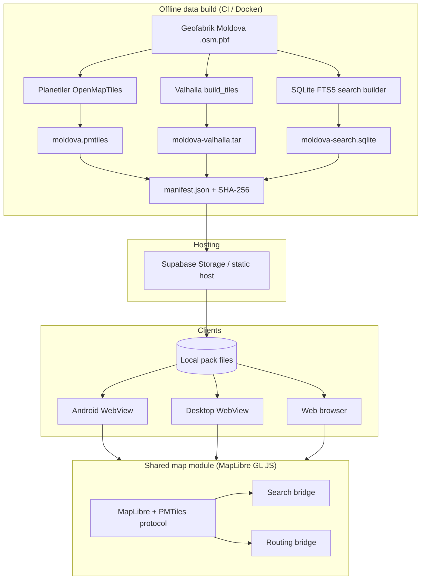

# Pinpoint 2.0 — Offline Maps for Moldova (Design)

**Status:** Proposed
**Date:** 2026-11-16
**Deciders:** repository owner
**Scope:** Moldova first; Android, desktop and web; offline basemap, offline search and offline turn-by-turn routing.
**Related:** ADR-0007 (Rust multiplatform), ADR-0017 (Android Java bridge), OSM/ODbL policy, `docs/security-architecture.md`.

## 1. Intent and why

Pinpoint's map currently needs a connection. The Android app has a small
"Download current area pack" raster cache, but it covers only the current
viewport at three zoom levels and has no search or routing. The web app has no
offline map at all. The goal is Organic Maps-style offline use: download
Moldova once, then browse the vector map, search for a place and navigate
without a connection.

This is a 2.0 project, not a patch. The current 1.5.3 build stays live as the
online preview while 2.0 is built.

## 2. Current state (facts)

- `src/map.rs` draws a custom egui raster-tile canvas. Tiles come from the
  backend `/map/tiles/{z}/{x}/{y}` proxy (CARTO/OSM raster).
- `src/tilepacks.rs` downloads PNG tiles for the current viewport at three
  zoom levels, capped at 4096 tiles and one request per second. It is a cache,
  not a region manager.
- `web/app/map.js` uses Leaflet with the same-origin raster tile layer. No
  offline packs.
- Android is a `NativeActivity` + eframe/egui app; desktop is eframe; the web
  client is vanilla ES modules served by the Rust server.
- `src/osm.rs` calls Nominatim, OSRM and Overpass online. There is no offline
  place index or routing graph.
- There is no vector renderer, PMTiles reader or routing engine in the tree.

## 3. Goals, non-goals, anti-goals

### Goals

- Download a **Moldova** offline pack: vector basemap, search index and routing
  graph.
- Browse, pan and zoom the offline vector map on Android, desktop and web.
- Search for places/addresses offline.
- Calculate car, walking and bicycle routes offline with visual turn-by-turn
  instructions.
- Show the existing friend pins, shares and location actions on the new map.
- Work with no network requests while offline; keep ODbL attribution visible.
- Make pack download, progress, storage, update and delete explicit.

### Non-goals for 2.0

- Worldwide packs. Moldova is the first region; the format must generalize.
- Live traffic, lane-level guidance, house-number interpolation beyond OSM data.
- iOS. The launch clients are Android, desktop and web; iOS can follow.
- Satellite imagery, 3D buildings or offline POI reviews.
- Replacing the Rust app shell, auth, friends, settings or privacy pages.

### Anti-goals

- Scraping `tile.openstreetmap.org` or any third-party tile server.
- Shipping proprietary map data (Google/Mapbox) or hidden telemetry.
- Requiring a connection for the core offline flow.
- Keeping location/search/route data on a server when the offline path is used.

## 4. Constraints

- **Rust multiplatform:** the shell stays Rust/egui; the map subsystem becomes a
  shared MapLibre GL JS component. This is a deliberate exception to ADR-0007's
  "Rust sole codebase" for the map only; a new ADR will record it.
- **Android:** `NativeActivity` + Gradle; Java bridge is allowed only for
  platform APIs with no Rust binding (ADR-0017). A WebView is such an API.
- **Web:** no CDN dependencies; vendor MapLibre, PMTiles, SQLite WASM and
  Valhalla WASM under `web/vendor/` and serve them same-origin.
- **OSM/ODbL:** Geofabrik extracts are allowed; attribution and share-alike
  terms must ship with every pack.
- **Storage:** keep the first pack under roughly 1 GB so Supabase Storage's free
  tier can host it; measure in M1.
- **Privacy:** packs are local; online fallback is opt-in and never includes
  friend coordinates or history.

## 5. Approaches considered

### A — MapLibre GL JS in a WebView + PMTiles + SQLite FTS5 + Valhalla (chosen)

One map stack for Android, desktop and web. The Rust shell hosts a WebView on
Android/desktop and the web app uses the same MapLibre module directly.
Offline basemap is a PMTiles file; search is SQLite FTS5; routing is Valhalla
(native) and Valhalla WASM (web).

- **Pros:** proven vector renderer; one map/style/data format; web parity;
  PMTiles is a single file with range reads; keeps the Rust shell.
- **Cons:** a WebView inside egui/NativeActivity; a second language for the map
  UI; Valhalla WASM maturity; pack size.

### B — MapLibre Native on Android/iOS + separate web map

- **Pros:** native mobile feel; built-in offline region APIs.
- **Cons:** two map stacks; desktop left behind; poor egui integration; iOS
  work. Rejected for a three-platform release.

### C — Rewrite the client as a PWA

- **Pros:** best web offline story; one UI.
- **Cons:** discards the Rust/egui client and ADR-0007; large rewrite. Rejected.

## 6. Architecture



### 6.1 Shared map module

A new `web/map/` module (vanilla ES modules, vendored libraries) owns the map,
search bar, route panel and offline-pack UI. Its public API is small:
`createMap`, `setLocations`, `setRoute`, `clearRoute`, `search`, `downloadPack`,
`deletePack`, `listPacks`, `setOffline`. The existing `web/app/map.js` becomes a
thin adapter so `app.js`/`nav.js` keep working.

On Android and desktop, the same module runs in a WebView and talks to Rust
through a bridge. On the web, the module runs directly and uses OPFS/service
worker.

**What runs where (settled):**

| Surface | Android / desktop | Web |
|---|---|---|
| Map canvas, search, route and pack UI | standalone `web/map/` page inside the WebView | MapLibre module behind the existing `web/app/map.js` API; web DOM owns the surrounding controls |
| Auth, friends, settings, privacy | Rust/egui shell | existing web app |
| Session/CSRF | never enters the WebView; the Rust shell performs API calls | existing web session |
| Bridge | JNI (Android) / `wry` + loopback HTTP server (desktop) | none; the page calls the module directly |

The egui Map screen is replaced by the WebView map page. The egui Route/Places
lists remain for non-map actions (sharing, saved places, handling), but search,
routing and pack management live in the shared map page. `nav.js` keeps its DOM
and calls the map module's `search`/`route` API instead of `/map/search` and
`/map/route`; the native map page does not have a session or CSRF token.

### 6.2 Bridge API

Native → JS: `setLocations`, `setCurrentLocation`, `setRoute`, `setTheme`,
`setOnline`, `setPacks`.

JS → native: `sharePin(lat, lon)`, `openProfile(userId)`, `getCurrentLocation()`,
`downloadPack(id)`, `deletePack(id)`, `route(request)`, `search(query)`.

Message format is JSON with a version field. The bridge validates ids, bounds
and lengths; it never accepts arbitrary SQL, file paths or URLs.

## 7. Data pipeline

A reproducible build under `scripts/offline/` (PowerShell wrapper + Docker
images) produces three artifacts and a manifest:

1. **Basemap:** Geofabrik `moldova-latest.osm.pbf` → Planetiler
   `openmaptiles/planetiler-openmaptiles` → `moldova.pmtiles` (z0–14, overzoom
   to 18). The OpenMapTiles schema is the contract; style layers must match.
2. **Search:** a new Rust CLI `pinpoint-offline-index` reads the PBF and writes
   `moldova-search.sqlite` with FTS5. Tables: `places` (id, name, normalized
   name, kind, lat, lon, address, importance) and `places_fts` (name, address).
   Diacritics are folded for Romanian/Moldovan queries.
3. **Routing:** Valhalla `valhalla_build_tiles` for auto, pedestrian and bicycle
   → `moldova-valhalla.tar`. The config pins the profiles and tile extract.
4. **Manifest:** `manifest.json` with `version`, `built_at`, `bbox`, `minzoom`,
   `maxzoom`, per-file `url`, `bytes`, `sha256`, and the ODbL license/attribution.

The pipeline runs in CI or locally with Docker. The manifest is published with
the files; the app never guesses URLs.

### Hosting (settled)

Packs are served directly from Supabase Storage (if enabled) or Cloudflare R2,
with a CSP `connect-src` allowlist for the pack origin. The manifest is
same-origin from the Pinpoint server. If neither is available for the first
users, a same-origin Range proxy is the fallback. The privacy page names the
pack host; direct downloads expose the user's IP to that host, as any download
does.

## 8. Offline basemap

- **Android/desktop:** the WebView loads MapLibre from a loopback HTTP server
  (`127.0.0.1`) that serves `web/map/` assets and pack files with HTTP Range
  support. PMTiles needs range requests; a local server is the reliable way to
  provide them on both platforms.
- **Web:** `pmtiles` protocol with an OPFS-backed source. A service worker
  caches the app shell, style, sprites and glyphs; PMTiles files live in OPFS
  and are read by range.
- **Online:** the same PMTiles file can be streamed from the host with range
  requests. The legacy raster proxy remains as a fallback for 1.x clients only.
- **Style:** an OpenMapTiles-compatible style (Liberty/Bright or a Pinpoint dark
  variant) with vendored sprites and glyphs. ODbL attribution is always visible.

## 9. Offline search

- Native: `rusqlite` (bundled, FTS5) opens the pack's SQLite file. Queries are
  prefix/ranked; results carry name, kind, coordinates and a bounding box.
- Web: SQLite WASM in a worker with OPFS. Same schema and ranking SQL.
- **Languages:** index `name`, `name:ro`, `name:ru`, `name:uk`, `name:bg`,
  `name:gag`, `name:en`, `alt_name`, `official_name` and `short_name`; display
  preference is ro → ru → uk → en → `name`. Diacritics are folded and Cyrillic
  queries work.
- UI: search bar in the shared map page; results list; tap to center; long-press
  or a route button to set a destination.
- Reverse geocode for "where am I" uses the nearest place in the pack; no
  network call.

## 10. Offline routing and turn-by-turn

- **Native (Android/desktop):** Valhalla C++ through a small FFI/JNI wrapper.
  The pack's `moldova-valhalla.tar` is loaded from app storage.
- **Web:** a Valhalla WASM build (`valhalla-browser` or
  `@jansoft/mbukanji-valhalla-wasm`) in a worker, with the same tiles. This is
  the highest-risk part: physical mobile browsers are not yet established by
  those projects. M1 includes a spike on Android Chrome and iOS Safari.
- **Profiles:** auto, pedestrian, bicycle. Route response: shape, distance,
  duration, maneuvers. The map draws the line; a banner shows the next maneuver.
- **Voice:** platform TTS (Android `TextToSpeech`, Web SpeechSynthesis, desktop
  OS TTS) as an M6 stretch; visual turn-by-turn ships first.
- **Outside coverage:** if origin/destination is outside the pack, show "outside
  offline area" and offer the online router. Never silently fall back.

### Native build and supply chain (settled)

Valhalla is built from source in CI with pinned Docker images: Valhalla for the
tiles, and the NDK/CMake toolchain for Android arm64, Windows x64 and macOS
arm64/x64 shared libraries. No opaque prebuilt binary is checked in. M1
validates the Android arm64 build. If that build is not feasible, the fallback
is a Rust A* router over the same OSM graph, compiled to native and WASM; the
routing engine sits behind a `Router` trait so the rest of the app is
unaffected.

## 11. Download manager, storage and updates

- Packs live in app-private storage: Android `filesDir`, desktop data dir, web
  OPFS.
- The manager downloads with HTTP Range resume, verifies SHA-256, writes to a
  temporary name, then atomically renames. A failed download never replaces a
  good pack.
- UI shows size before download, progress, speed, cancel, storage used, delete
  and update. The manifest is checked on launch (online only); updates are
  opt-in.
- Storage guard: refuse to start below 500 MB free; warn on metered networks.

## 12. UX sketch

```text
Offline maps
  Moldova                         [Download]   ~size shown from manifest
  [========------] 62%   18.4 / 29.7 MB       Cancel
  Installed
    Moldova 2026-11-16            [Update] [Delete]
    Basemap · Search · Routing · © OpenStreetMap contributors (ODbL)

Map
  [ Search a place... ]                         [Offline ●]
  +------------------------------------------------------+
  |        vector map, friend pins, route line            |
  +------------------------------------------------------+
  [My location] [Route] [Layers]

Route
  From: Current location
  To:   Bălți
  [Auto] [Walk] [Bike]         12.4 km · 18 min
  [Start]   next: turn right onto Ștefan cel Mare
```

## 13. Platform integration

### Android

- Add a `WebView` to `PinpointActivity` (Java) and show it only on the map
  screen; the egui surface stays for every other screen.
- Start a loopback HTTP server in Rust (`axum` or `tiny_http`) serving
  `web/map/` and the packs with Range support.
- `@JavascriptInterface` bridge for the methods in §6.2; no remote navigation,
  no file access, CSP locked to the loopback origin.
- Packs in `filesDir`; no external storage permission.
- **Supported floor (settled):** `arm64-v8a` only, minSdk 26, WebView 100+ with
  WebGL2. The 1.5.3 raster APK stays available for older/armv7 devices; 2.0 does
  not ship armv7.
- Test on Android 15/16 KB page-size devices and a low-end arm64 phone.

### Desktop

- Embed a `wry` WebView in eframe (WebView2 on Windows, WebKitGTK on Linux,
  WKWebView on macOS) using the same loopback server and bridge.
- **Release scope (settled):** Windows 10/11 (WebView2) and macOS 12+ (WKWebView)
  are release-gating. Linux is best-effort: a separate map window or
  system-browser hand-off, or no 2.0 map initially. M4 spikes embedded `wry`; a
  separate window is the fallback.

### Web

- Replace Leaflet in `web/app/map.js` with the shared MapLibre module.
- Vendor MapLibre, `pmtiles`, `@makina-corpus/maplibre-offline-pmtiles` (or a
  small OPFS source), SQLite WASM and Valhalla WASM under `web/vendor/`.
- Add `web/sw.js` for the app shell/style/glyphs; OPFS for packs; COOP/COEP
  headers where SharedArrayBuffer is required.
- Keep the existing auth/session/CSRF and privacy behavior unchanged.

## 14. Online/offline behavior

- Offline: no requests to the backend, Nominatim, OSRM, CARTO or any tile host.
- Online: the app can stream the same PMTiles and use the existing online
  Nominatim/OSRM as a fallback; it never sends friend coordinates to a map
  provider.
- The offline badge is explicit; the app never claims offline readiness before
  a pack is verified.

## 15. Security and privacy

- WebView: local assets only, strict CSP, navigation allowlist, no file access,
  bridge validation, no secrets in the page.
- Packs: HTTPS, SHA-256 verification, atomic replace; optional signature later.
- Data: no analytics, no third-party tile calls, no server-side route/search
  history. Offline search and routing stay on the device.
- ODbL: attribution on the map, About and each pack; license text shipped with
  the pack. Derived databases are distributed under ODbL.

## 16. Testing and acceptance

- Unit: manifest parsing, SHA-256, resume, FTS query ranking, route request
  validation, tile math.
- Web: Playwright offline test with a small fixture pack; verify no network.
- Android: emulator/device smoke; install pack, airplane mode, map/search/route.
- Desktop: Windows + Linux smoke; WebView2/WebKitGTK.
- Acceptance for Moldova in airplane mode:
  - map renders z6–14 and pans/zooms;
  - search finds "Bălți" and "Chișinău";
  - route Chișinău → Bălți by car, walk and bike with maneuvers;
  - friend pins and shares render;
  - delete removes the pack and frees storage;
  - update replaces the pack atomically;
  - zero network requests while offline.
- ODbL attribution visible on every map and in About.

## 17. Milestones and timeline

| Milestone | Deliverable | Estimate |
|---|---|---|
| M1 | Moldova pipeline, manifest, sizes measured; Valhalla WASM spike; web MapLibre online | 2–3 weeks |
| M2 | Web offline PMTiles + OPFS + service worker + download UI | 2 weeks |
| M3 | Android WebView map + loopback server + bridge | 3 weeks |
| M4 | Desktop WebView map | 2–3 weeks |
| M5 | Offline search (native SQLite + SQLite WASM) | 3 weeks |
| M6 | Offline routing + turn-by-turn (native Valhalla + WASM) + voice | 4–5 weeks |
| M7 | Parity polish, ODbL/security review, cross-platform tests, 2.0 release | 2 weeks |

**Total:** roughly 18–22 weeks for one engineer; some work can run in parallel.
The 1.5.3 online build stays live during this.

## 18. Risks and mitigations

| Risk | Impact | Mitigation |
|---|---|---|
| Valhalla WASM on mobile browsers | Web full parity slips | M1 spike on real phones; fallback to a Rust router in WASM or online routing on web (decision point) |
| WebView embedding in egui | Android/desktop UX | M3/M4 spikes; fallback separate map window |
| Pack size / mobile downloads | Users abandon downloads | Measure M1; z0–14; show size; resume; Wi-Fi warning |
| Routing quality | "Parity" disappointment | Valhalla profiles; Moldova-only first; document limitations |
| ODbL compliance | Legal | Attribution, license files, derived-DB notice |
| ADR-0007 conflict | Thesis scope | New ADR explicitly amends the map clause |
| Timeline | Launch slips | 1.5.3 stays live; 2.0 is a separate release |

## 19. ADR impact

Add `docs/adr/0020-hybrid-maplibre-offline-maps.md` (Proposed) that:

- amends ADR-0007 for the map subsystem: MapLibre GL JS in a WebView is allowed;
- replaces "no bulk tile caching in-app" with region packs;
- records the OSM/PMTiles/Valhalla data pipeline and ODbL obligations.

The ADR is part of the 2.0 PR, not this design doc.

## 20. Decisions left to the builder

- Exact style (Liberty/Bright/custom) and dark/light defaults.
- Pack hosting after M1 size measurement (Supabase Storage vs R2).
- Whether voice guidance ships in M6 or a follow-up.
- Whether the web router uses Valhalla WASM or a Rust WASM fallback if the
  spike fails.
- Exact search ranking weights and diacritic folding rules.
- Whether desktop uses an embedded WebView or a separate map window if the
  spike is unstable.

## 21. Decisions settled for this design

1. **ADR-0007 exception:** architecture A is the chosen direction. The map
   subsystem uses MapLibre GL JS in a WebView; ADR-0020 records the exception
   and is accepted before M1. The rest of the client stays Rust/egui.
2. **What runs where:** native uses a standalone `web/map/` page with the bridge;
   web uses the same module behind `web/app/map.js`. The native WebView never
   receives session or CSRF material.
3. **Android floor:** arm64 only, minSdk 26, WebView 100+ with WebGL2. The 1.5.3
   raster APK remains for older/armv7 devices.
4. **Desktop:** Windows 10/11 and macOS 12+ are release-gating; Linux is
   best-effort (separate window, browser hand-off, or no 2.0 map initially).
5. **Web offline:** works signed out for map/search/routing; friend pins are not
   persisted after reload. Desktop Chromium/Firefox and Android Chrome are
   release-gating; iOS Safari is best-effort.
6. **Online fallback:** offline-first when a verified pack exists. The online
   fallback is explicit. Friend coordinates go only to a self-hosted router or
   after a consent prompt; never silently to a third party.
7. **Pack hosting:** direct Supabase Storage or Cloudflare R2 with a CSP
   allowlist; the manifest is same-origin. A same-origin Range proxy is the
   first-users fallback.
8. **Search languages:** all major `name:*` tags for Moldova (ro, ru, uk, bg,
   gag, en) plus official/alt/short names; display preference ro → ru → uk →
   en → `name`.
9. **Native Valhalla:** built from source in CI with pinned toolchains. If the
   Android arm64 build is not feasible in M1, a Rust A* router over the same OSM
   graph is the fallback, behind a `Router` trait.
10. **Voice:** visual turn-by-turn is the 2.0 requirement; voice is an M6
    stretch. **iOS:** out of scope for 2.0. **Updates:** monthly OSM extract,
    manually triggered, immutable pack versions.
11. **Web routing contingency:** M1 spikes Valhalla WASM on mobile browsers. If
    it fails, web ships offline map+search with online routing and full web
    routing moves to a follow-up. This is the only fallback that changes the
    release criteria.

## 22. Approval

This design is ready for approval. Once approved, the next step is the
implementation plan (`writing-plans`), not code. The approval covers:

- architecture A (MapLibre GL JS in a WebView + PMTiles + SQLite FTS5 +
  Valhalla), including the ADR-0007 exception;
- Moldova first, Android + desktop + web;
- the platform floors and hosting/privacy calls in §21.

