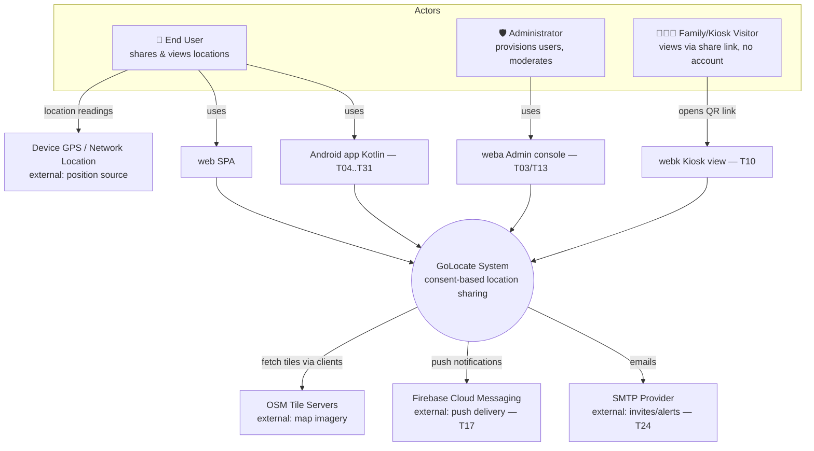

# 01 — System Context (C4 L1) 📋

**Notes**
- The four clients all talk to the same Go API (`/api/v1`); `webk` uses short-lived signed share tokens instead of accounts.
- Tiles are fetched by the browsers/app directly from OSM (system stores only coordinates).
- Traceability: FR-consent, FR-friendship, FR-map (see TRACEABILITY.md), tasks T03/T04/T10/T17/T24.
