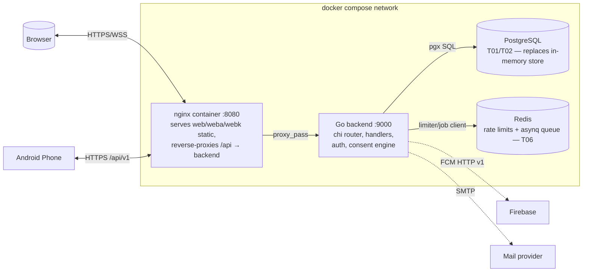

# 02 — Container Diagram (C4 L2) 📋

Deployment as defined in `docker-compose.yml` + planned services (T01, T06).

**Protocols & boundaries**
| Edge | Protocol | Auth |
|------|----------|------|
| Browser↔nginx | HTTPS, WSS (T07) | session cookie + CSRF header |
| App↔nginx | HTTPS | session/JWT, keystore-held |
| nginx↔backend | internal HTTP | none (private network) |
| backend↔PG | TCP 5432 | DSN secret |
| backend↔Redis | TCP 6379 | optional AUTH |

**Single-binary mode:** `WEB_ROOT` set → Go serves clients itself (no nginx container) for simple deploys.
