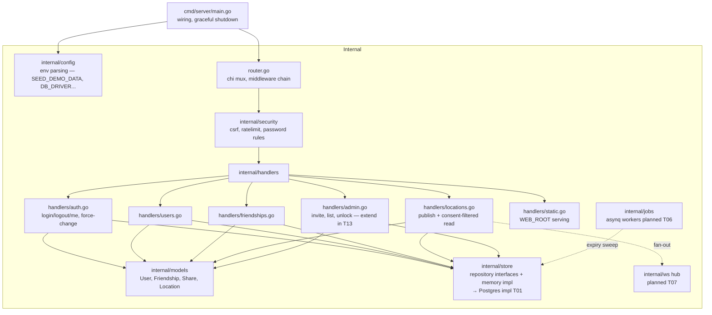

# 03 — Backend Component Diagram (C4 L3) 📋

Mirrors actual Go package layout under `backend/`.

**Middleware order (current):** RequestID (T15) → RateLimit → Recoverer → CORS → CSRF (state-changing) → Auth(jwt/session) → Role(admin).
