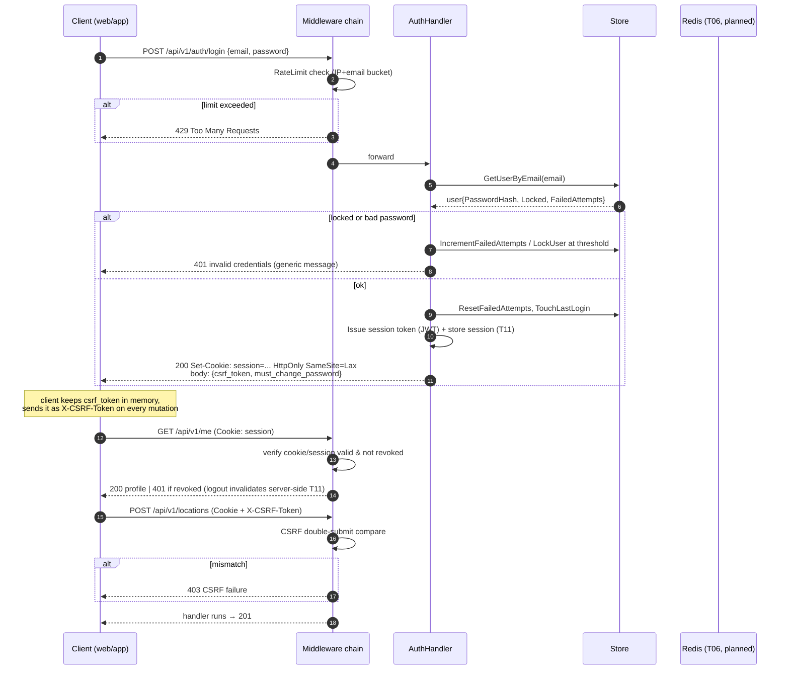

# 05 — Sequence: Authentication (login → session + CSRF) 📋

Matches current Go handlers (`internal/handlers/auth.go`, `internal/security`).

Forced password change: when `must_change_password=true`, middleware blocks all non-`/auth/change-password` routes with 403 `PASSWORD_CHANGE_REQUIRED`.
