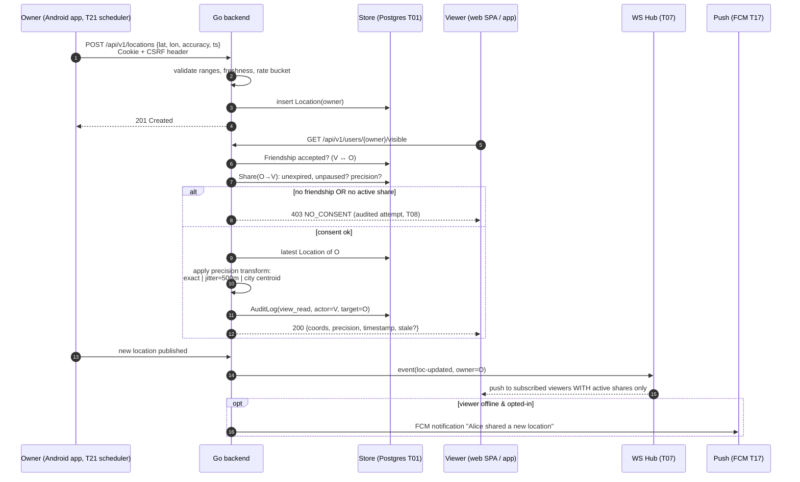

# 06 — Sequence: Location publish → consent-checked read → fan-out 📋

Key rule visualised: **precision is applied server-side at read time**; raw coordinates never leave the system at higher precision than the Share grants. Stale flag = timestamp older than freshness threshold shown like web UI states.
