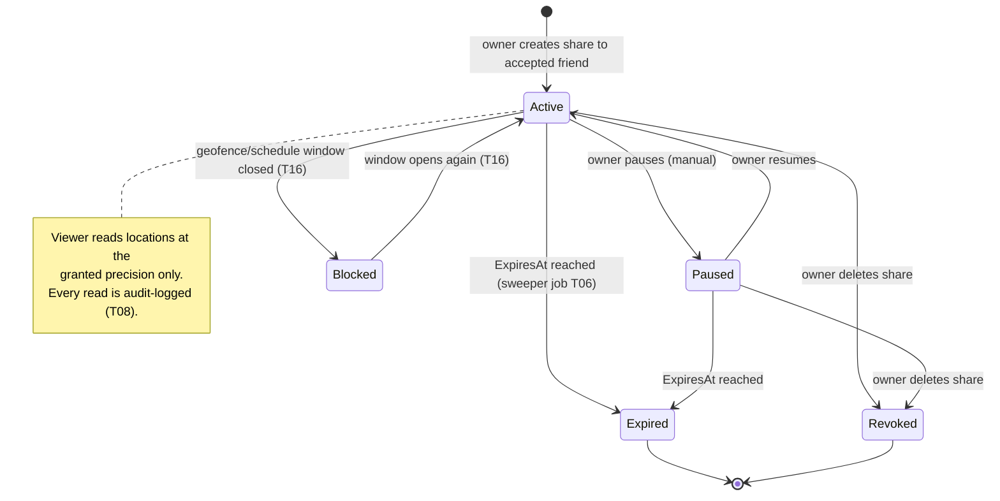
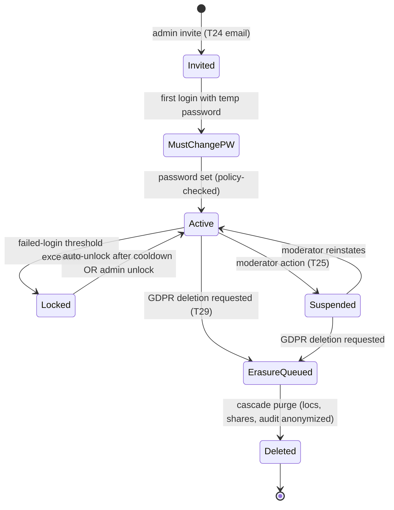

# 08 — State Diagrams: Share & Account 📋

## Share lifecycle (directional consent)

## Account lifecycle

Both machines are enforced server-side in handler guards; clients merely reflect them (badges in web/weba, screens in Android).
