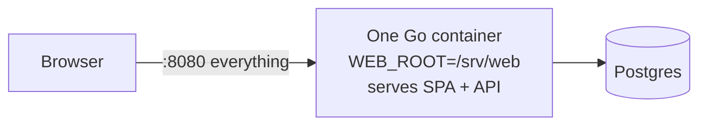
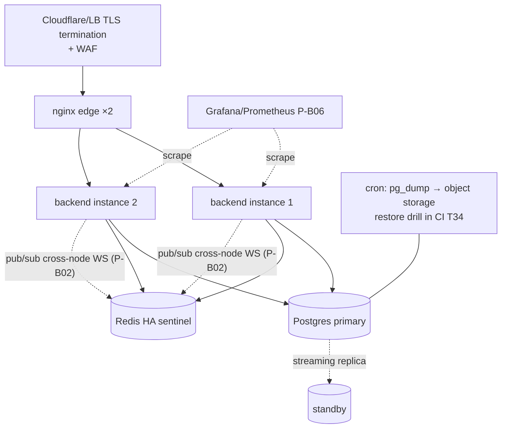

# 10 — Deployment Diagrams 📋

## A. Development / demo (current `docker-compose.yml`)

```mermaid
graph TB
    subgraph Host["Developer machine / VM — docker compose up --build"]
        subgraph Net["compose network"]
            W[web container<br/>nginx :8080 → serves SPA,<br/>proxies /api]
            BE[backend container :9000<br/>Go binary, SEED_DEMO_DATA=true,<br/>healthcheck /health]
            PG[(postgres:16-alpine<br/>volume pgdata)] ## T01 active
            RD[(redis:7-alpine<br/>volume redisdata)] ## T06 active
        end
    end
    BR[Browser localhost:8080] --> W
    W -->|proxy /api/v1| BE
    AE[Android emulator<br/>10.0.2.2:8080] --> W
    BE --> PG
    BE --> RD
```

## B. Single-binary minimal mode



## C. Production target (post-T34)



Runbook lives in [docs/DEPLOYMENT.md](../DEPLOYMENT.md); secrets policy in SECURITY.md; task refs T05/T34/T36.
