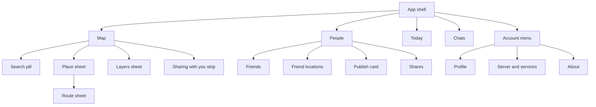
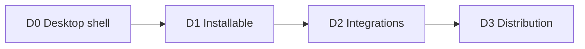

# Next: a mobile look based on the web UI, and real Windows and Linux apps

Status: proposal. Nothing here is built or scheduled, and there are no dates.
Reviewed 2026-11-26 against `main` and the web redesign in PR #601 (open at the
time of writing).

This file covers two things:

1. How the Android app (and iOS later) should look and be laid out, using the
   redesigned web shell as the reference.
2. A plan for Windows and Linux desktop apps that feel made for the desktop.

Both keep [ADR-0007](../docs/adr/0007-rust-multiplatform.md): one Rust crate,
egui for the UI, platform code only in `src/platform.rs`. A section says so
when it proposes to change that.

## Summary

- The native app and the web app are two different designs. The web client was
  redesigned (Limestone background, Codru green, Sunflower only for "shared
  right now", four tabs, one sheet style). The native client still has the old
  dark-green and amber look and a five-tab bar. The test that is meant to keep
  them in step compares against hard-coded values, so it cannot notice the web
  change.
- Mobile: take the web design as the source of truth. One token set read by
  both clients, four floating tabs, the account in an avatar menu, one sheet
  component with drag detents, and the live-sharing strip on the map.
- Desktop: Windows, Linux and macOS builds already ship from the same crate as
  unsigned zips. What is missing is a desktop-shaped layout, installers,
  signing, OS location, and updates through the OS instead of a link.
- Order: tokens first (both targets need them), then the phone shell, then the
  desktop shell, then packaging.

## Where things stand

| Area | Today | Where to look |
|---|---|---|
| Palette | Native: dark green with an amber accent (`#e3a458`) and cream text. Web redesign: light by default, forest-night dark, Sunflower reserved for live sharing. | [`src/ui/theme.rs`](../src/ui/theme.rs), [`web/app/app.css`](../web/app/app.css) |
| Palette parity test | `palette_matches_the_web_shell` asserts literal values. It never reads `app.css`, so a web redesign passes it silently. | `src/ui/theme.rs` tests |
| Phone navigation | Five full-width tabs (Map, Friends, Sharing, Today, Me), the selected tab filled with the accent, plus a drawer grid of all 16 screens. | `mobile_tabbar`, `draw_nav_drawer` in [`src/ui.rs`](../src/ui.rs) |
| Web navigation | Four floating tabs with icons (Map, People, Today, Chats). Account sits in an avatar menu. A "Sharing with you" strip shows who is live. | PR #601 |
| Wide layout | At 820 px and up: a 380 px drawer on the right, overlaying the map below 1100 px. | `WIDE_LAYOUT_MIN_WIDTH` in `src/ui.rs` |
| Bottom inset | The tab bar hard-codes a 20 pt bottom margin for the Android gesture bar. | `mobile_tabbar` in `src/ui.rs` |
| Android accessibility | `accesskit` only works with the game-activity backend, so the native-activity build used here has no accessibility tree for TalkBack. Needs a check on a device. | comment above the eframe dependency in [`Cargo.toml`](../Cargo.toml) |
| iOS | Scaffold. It cannot be built on the Windows dev host and no macOS CI result is recorded. | [`ios/README.md`](../ios/README.md) |
| Desktop releases | Windows, Linux and macOS zips plus verify jobs. Unsigned, so Windows SmartScreen warns. | [`release.yml`](../.github/workflows/release.yml), `packaging/` |
| Desktop location | Only Android reads the OS location. Elsewhere `EnvOrFileGpsProvider` reads an environment variable or a file, and publishing falls back to manual entry. | [`src/platform.rs`](../src/platform.rs) |
| Desktop map | The egui map. The MapLibre window is opt-in (`map-webview` feature, a child process using WebView2 or WebKitGTK) and needs the `web/` tree next to the executable. | [README](../README.md), ADR-0020 |
| Updates | Notify only: a once-a-day check and a link to the release page ([ADR-0015](../docs/adr/0015-launch-time-update-check.md)). | |
| Linux hands-on run | `packaging/linux/README.md` records no GUI run on a Linux host. | [`packaging/linux/README.md`](../packaging/linux/README.md) |
| Old scaffold | `mobile/` (Kotlin, Compose) is still tracked, although ADR-0007 and `AGENTS.md` rule out a Kotlin app. Decide separately whether to delete it. | [`mobile/README.md`](../mobile/README.md) |

---

## Part 1: the mobile app

### 1.1 What the web redesign decided

These carry over unchanged:

- The map comes first. Everything else is a sheet or a short list over it.
- One colour means "live": Sunflower, used only for sharing right now (live
  dot, "Sharing with you" strip, friend pins). It is never a button, link or
  selected-tab colour.
- Four destinations, not five, and the account is not one of them.
- Controls are pills. Sheets and cards use a 14 px radius. Text is sentence
  case, with no small-caps section labels.
- The state of sharing is always on screen, never behind a menu.

### 1.2 Look

One set of tokens, with the web CSS as the source.

| Role | Web light | Web dark | Native today |
|---|---|---|---|
| Background | `#e9ece6` Limestone | `#0e1f17` | `#0c1512` |
| Panel | `#f8faf6` Chalk | `#15291f` | `#12201b` |
| Panel 2 | `#eef1eb` | `#1b3327` | `#172a22` |
| Border | `#d3dacf` | `#2a4334` | `#2a3c33` |
| Text | `#16261d` | `#e6eee6` | `#f0eadc` |
| Muted | `#5e7266` Lichen | `#9fb2a5` | `#a5b2a6` |
| Accent | `#18382a` Codru | `#a7d8b6` | `#e3a458` |
| Live | `#f4c21b` Sunflower | `#f4c21b` | none (amber does everything) |
| Danger | `#b42318` Brick | `#f0857a` | `#e06c5a` |

Rules:

1. **Parity by test.** A Rust test reads `web/app/app.css`, takes the `:root`
   and `[data-theme="dark"]` custom properties, and asserts that `theme.rs`
   matches. Changing either side without the other fails CI. This replaces the
   literal-value test.
2. **Light and dark.** Native is dark only today. Add the light theme, follow
   the system setting, and allow a manual override like the web toggle.
3. **Selected tab.** Accent-coloured icon and label with a short underline, as
   on the web. Not a filled block.
4. **Buttons.** Pills. One filled primary action per screen or sheet; the rest
   are outlined.
5. **Type.** Keep body at 15 pt and the 12 pt floor. Honour the system font
   scale up to at least 130% without clipping the tab bar or sheet headers.

### 1.3 Layout

Where each of the 16 native screens goes:

| Native screen | New home | Note |
|---|---|---|
| Map, Places, Bookmarks | Map | Saved places appear as a chip and in search results, not a separate screen. |
| Friends, Sharing, Emergency | People | Friends, friend locations, publish card, shares card in that order (the same order as the web, so keyboard and screen-reader order match the visual order). Emergency becomes a card here; keep it one tap from People. |
| Today, Trips | Today | Confirm what Trips holds when building. If it is saved routes it belongs in the route sheet instead. |
| Messages | Chats | Unread count on the tab label, as on the web. |
| Profile, ChangePassword, About | Account | Opened from the avatar menu. |
| Admin, Kiosk | Account | Admin shows only for administrators. Kiosk is a check-in screen for a shared kiosk link; confirm it still needs a menu entry. |
| Login, Register | Outside the tabs | Full screen, no tab bar, like the web auth card. |



Phone map screen (360 by 800 baseline):

```text
+------------------------------+
| Sharing with you             |  only when someone is live
| Ana  live    Radu  4 min     |
|                              |
|       (full-bleed map)       |
|                           (o)|  layers
|                           (o)|  my location
| ( Search places       ) (A)  |  search pill + avatar menu
| +--------------------------+ |
| |  Map  People Today Chats | |  floating tab bar
| +--------------------------+ |
+------------------------------+
```

The search pill sits above the tab bar, inside thumb reach, as on the web.

Sheets use one component with three heights:

```text
peek: title + one action    half: details    full: steps, forms
+----------------------+    +--------------+  +--------------+
|        ----          |    |    ----      |  |    ----      |
| Parcul Valea Morilor |    | title        |  | title        |
| [ Directions ]       |    | actions      |  | actions      |
+----------------------+    | info rows    |  | info, steps, |
                            +--------------+  | notes        |
                                              +--------------+
```

The web route sheet has two heights today (open and collapsed). Three is a
proposal; keep two if testing shows the middle one is not used.

Sizing rules:

- 44 pt minimum targets (already true in `theme.rs`).
- The tab bar floats 8 pt above the bottom inset. Read the real system inset
  through `src/platform.rs` and drop the hard-coded 20 pt.
- Android Back closes the open sheet first, then goes back to Map, then
  leaves the app.
- A sheet that holds a text field moves above the on-screen keyboard.

### 1.4 Components

One set, used by every screen; no screen draws its own frames.

| Component | Replaces | Notes |
|---|---|---|
| `pill_button`, `icon_button` (44 pt) | ad-hoc buttons | primary, outlined and danger variants |
| `search_pill` | the search row in `ui/map.rs` | clear button, loading and error text under it |
| `sheet` with detents | share, route, place and publish sheet frames | drag handle, close, one-time focus on the close button (already tested) |
| `list_row` | cards for friends and shares | avatar, name, status line, age ("2 min"), live dot |
| `status_banner` | update banner and error text | offline, server unreachable, update available |
| `empty_state` | blank screens | what is missing and the one action to fix it |

`card`, `full_card`, `card_title`, `caption` and `primary_button` in
`theme.rs` stay and are re-themed.

### 1.5 States that must always be visible

- **Sharing.** Who can see you right now, on the Map, with a stop control.
- **Freshness.** Friend rows show the age of the last location. Old ones fade.
- **Offline or server down.** A banner, and search falls back to the offline
  pack, then saved places and map names, then says what it could not do. The
  web already does this (PR #605); the native search should use the same order.
- **Which server.** Account shows the server in use and lets you change it,
  with the same rule as the web (PR #607): https, or plain http only for this
  computer. Native has `--backend`; add a settings field.
- **Permissions.** Location denied or approximate gets one sentence and one
  button to the system settings.

### 1.6 Android and iOS specifics

- **Accessibility on Android.** Check TalkBack on a real device. If egui on the
  native-activity backend exposes nothing useful, that is a release blocker
  for calling the redesign done, and the decision in 1.8 comes forward.
- **Dark mode and font scale** follow the system.
- **Edge to edge.** Android 15 draws behind the system bars; use real insets.
- **iOS** waits until the Android shell is done. It needs a macOS CI job that
  builds the scaffold before any design work is worth doing there.

### 1.7 Build order

| Step | What | Done when |
|---|---|---|
| M0 Tokens | CSS-backed parity test, light and dark in `theme.rs`, Sunflower for live only | CI fails if the web and native tokens differ; both themes render every screen readable |
| M1 Shell | Four floating tabs, avatar menu, search pill above the tab bar, live strip, real insets | The 16 screens are reachable from the table in 1.3; no drawer needed on a phone |
| M2 Sheets | One `sheet` component for place, route, publish and share, with Back handling | Existing sheet interaction tests pass unchanged; Back closes sheet then screen |
| M3 People and Today | `list_row` and the web card order | Keyboard and reading order match the visual order |
| M4 States and a11y | Banners, offline search order, server field, TalkBack pass | A device checklist is recorded in the PR |

Each step is its own PR, based on `main`, per `AGENTS.md`. The client already
has a headless `--screenshot <PATH>` mode that CI does not use yet. Capturing
screens at 360 by 800 and 1280 by 800 as build artifacts would let reviewers
see a change without a device; check whether the mode can start on a given
screen and add that if it cannot.

### 1.8 Considered and not chosen

- **Wrap the web app in a WebView shell.** It would match the web exactly, but
  the web client depends on same-origin cookies, CSRF and a server it can
  reach, and it needs a server for first load. It also reverses ADR-0007.
  Revisit only if egui cannot reach acceptable text input and accessibility on
  Android after M4.
- **Rewrite the Android app in Compose.** Ruled out by ADR-0007. The tracked
  `mobile/` scaffold would be the starting point if that ever changes.

---

## Part 2: Windows and Linux

### 2.1 Aim

A desktop app is not a stretched phone app. It should open to a three-part
window, work from the keyboard, install without a terminal, and update through
the channel the user already trusts. Phone width (under 820 px) keeps using the
phone layout, so a narrow window still works.

### 2.2 Layout

```text
+------+-----------------------+------------------------------------+
| Map  | People                |                                    |
| Ppl  | Friends               |                                    |
| Today|  Ana    live          |            (map)                   |
| Chats|  Radu   4 min         |                                    |
|      | Publish my location   |                              (o)   |
|      | Shares                |                              (o)   |
| (A)  |                       | [ Search places               ]    |
+------+-----------------------+------------------------------------+
  rail        list / details                 map fills the rest
  72 px         360 px, collapses
```

- A 72 px left rail holds the four destinations and the account avatar.
- A 360 px column holds the list or details. A place opens there instead of in
  a bottom sheet; routes too. The column collapses to give the map the full
  window.
- The map fills the rest, with the search pill and layer controls over it.
- This replaces the 380 px right-hand drawer.

### 2.3 Desktop behaviour

| Topic | Plan |
|---|---|
| Keyboard | `/` search (exists), `Esc` closes the open panel (exists), `Ctrl+1` to `Ctrl+4` switch tab, `Ctrl+,` opens Account. Visible focus rings everywhere. |
| Window | Remember size, position and column state. Minimum 360 by 600. |
| Scaling | Test 100%, 150% and 200% on Windows, and fractional scaling on Wayland. |
| Theme | Follow the system light or dark setting; manual override. |
| Location | Opt-in OS providers behind the existing GPS provider trait in `platform.rs`: Windows Geolocation, and GeoClue2 over D-Bus on Linux. Desktop fixes are often coarse (Wi-Fi or IP), so show the accuracy honestly. Manual entry stays. |
| Sharing indicator | A tray or taskbar indicator while location is being shared. On GNOME there is no tray by default (it needs an AppIndicator extension), so the window title and the Map strip stay the primary indicator. |
| Notifications | Windows toast and freedesktop notifications. No names or coordinates in the text, because lock screens and screen shares show them. |
| Files | Native open and save dialogs for GPX, KML and GeoJSON export. |
| Map | Ship the `web/` tree beside the executable so the MapLibre window works, and check WebView2 (Windows) and WebKitGTK (Linux) at startup with a clear message when missing. The egui map stays the fallback. |
| Accessibility | `accesskit` is available on desktop, so test with NVDA (Windows) and Orca (Linux). |

### 2.4 Packaging and distribution

Windows:

| Item | Plan |
|---|---|
| Installer | Per-user installer, no admin rights. MSI through WiX, MSIX, or an Inno Setup style installer; pick one in an ADR. Start Menu entry, icon, uninstall. |
| Signing | A code-signing certificate or a managed signing service, so SmartScreen stops warning. Needs a budget decision. |
| Dependencies | WebView2 runtime check (evergreen), with a link when missing. |
| Distribution | GitHub release, then a `winget` manifest pointing at the signed installer and its SHA-256. |

Linux:

| Item | Plan |
|---|---|
| `.deb` | `cargo-deb` is already documented in `packaging/linux/README.md`; add it to the release job and the verify job. |
| AppImage | A single-file option for other distributions; note the FUSE requirement on newer systems. |
| Flatpak | Preferred for non-Debian distributions. Permissions: network, Wayland and X11, GPU, and the location and notification portals. Needs AppStream metadata. |
| Desktop entry and icon | One `.desktop` file. `packaging/pinpoint.desktop` and `packaging/linux/pinpoint.desktop` both exist and already differ, so merge them into one. |
| `.rpm` | `cargo-generate-rpm`, lowest priority. |
| Sessions | Test X11 and Wayland, and a software-rendering fallback for virtual machines, since the renderer needs OpenGL. |

### 2.5 Updates

ADR-0015 keeps the app from downloading or installing anything. That stays the
rule. Do not build a self-updater. Use the package channels (winget, the
Flatpak remote, apt), and keep the existing once-a-day, opt-out notification
as the reminder. If a signed in-app installer is ever wanted, it needs a new
ADR that amends ADR-0015 and covers signature verification.

### 2.6 Testing and CI

- Keep the `windows-latest` and `ubuntu-latest` release builds, and add a smoke
  step that runs the existing `--screenshot <PATH>` mode (under `xvfb-run` on
  Linux) and keeps the PNG as an artifact.
- Run the installer: install, start `--help`, check the version, uninstall.
  Do this in the verify jobs that already unzip the packages.
- Keep a short manual checklist for what CI cannot see: HiDPI, Wayland,
  NVDA and Orca, a keyboard-only run, and a first run with no network.

### 2.7 Milestones



| Step | What | Done when |
|---|---|---|
| D0 Desktop shell | Tokens from M0, rail plus list plus map layout, shortcuts, window state | The three-part layout replaces the drawer at 820 px and up; narrow windows keep the phone layout |
| D1 Installable | Per-user Windows installer, `.deb` and AppImage, icon and desktop entry, `web/` shipped, WebView check | A clean Windows 11 and Ubuntu LTS machine install, start, show the map and uninstall without a terminal |
| D2 Integrations | OS location providers, notifications, file dialogs, tray where it exists | Sharing from a desktop works with the OS permission prompt; denying it falls back to manual entry |
| D3 Distribution | Signed Windows build, `winget` manifest, Flatpak | A user installs and updates through winget or Flatpak and SmartScreen does not warn |

D0 can start as soon as M0 is merged. D1 to D3 do not depend on the phone
shell.

---

## Rules that hold on every platform

- No analytics, trackers or ad identifiers. The update check stays opt-out and
  sends no account, location or device identifier.
- Friend and shared coordinates are never sent to a third-party geocoder,
  router or tile server ([OSM policy](../docs/OSM_POLICY.md)).
- Plain http only for a server on this computer; https everywhere else
  ([ADR-0006](../docs/adr/0006-rust-client-transport-and-session-contract.md)).
- The account email stays off the main screens, so a screen share shows the
  public handle only.
- Notifications and the tray never show names or coordinates.
- Every screen works with the server unreachable, with whatever is on the
  device.

## Decisions needed

1. **Android accessibility.** If TalkBack cannot read the egui build, do we
   accept that for now, switch backend, or move to the option in 1.8?
2. **Windows installer format** (MSI, MSIX or an Inno Setup style installer)
   and **who pays for signing**.
3. **Flathub or a self-hosted Flatpak remote.**
4. **Three sheet heights or two.**
5. **Default theme:** follow the system (proposed) or keep dark first.
6. **Delete `mobile/`?** It contradicts the Rust-only decision.

## Not in this plan

macOS and iOS packaging beyond what already builds, server changes, and any
change to the privacy model. macOS benefits from the same desktop shell (D0)
without extra design work.
