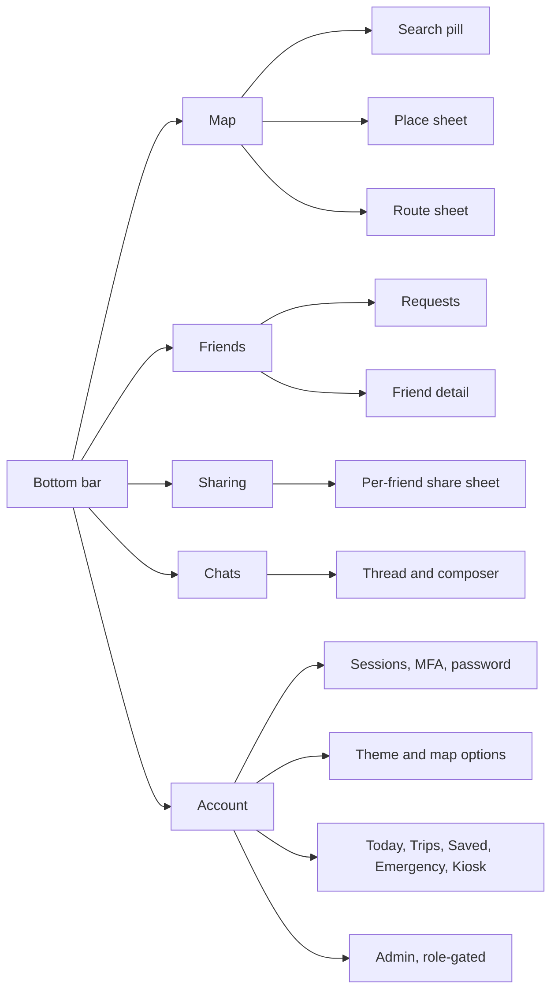

# Future plan: mobile UI and Windows/Linux desktop apps

Status: proposal, not accepted. Nothing in this document changes code.
Date: 2026-11-26. Based on `main` at `21947da`. Line numbers may drift.

## 1. Summary

- The mobile app is the Rust egui client packaged for Android (ADR-0017). It
  works, but it does not look or navigate like the web client. The two should
  read as one product.
- Recommended mobile direction: five bottom tabs shared by both clients (Map,
  Friends, Sharing, Chats, Account), Messages promoted out of the "More" sheet,
  one token set with light and dark themes, and larger tab labels.
- The desktop binary already builds on Windows, macOS and Linux, and every
  release attaches it as an unsigned ZIP. "Desktop apps soon" therefore means
  installers, signing and real GUI smoke tests. It does not mean a new UI.

Section 8 lists the decisions the owner needs to make.

## 2. Where things stand

### 2.1 Web UI (`web/app/`, served at `/`)

- Entry point `web/app/index.html`, styles `web/app/app.css` (2,304 lines),
  logic `web/app/app.js` (2,462 lines). The server embeds them with
  `include_str!` (`src/server/web_handlers.rs:14-33`).
- Theme: light by default, dark on request. The choice is stored under
  `pinpoint.theme.v1` (`web/app/appearance.js:6`). Colors are CSS variables
  (`web/app/app.css:3-37`).
- Brand: a serif stack for headings (`--serif`, Iowan Old Style, Palatino,
  Georgia).
- Navigation: a floating tab bar with six tabs (Map, Friends, Sharing, Today,
  Chats, Account) at every width (`web/app/index.html:615`). Its labels are
  0.68 rem on narrow screens (`web/app/app.css:1948`).
- Wide screens (981 px and up) get a 380 px side drawer. The tab bar shifts left
  to make room (`web/app/app.css:2061`, `2100`).

### 2.2 Mobile app (Android, `android/` and `src/`)

- Same Rust crate as desktop. cargo-apk builds the library and Gradle packages
  it with the Java bridge (`android/README.md`, ADR-0017).
- The palette is hard-coded in `src/ui/theme.rs` and is dark only. A unit test
  pins its values to the dark web palette (`src/ui/theme.rs:179-187`).
- The compact layout is used on every phone and on desktop windows narrower than
  820 pt (`src/ui.rs:43`, `src/ui.rs:1127`).
- Bottom tab bar: a 74 pt container with five 46 pt buttons and 12 pt labels.
  Tabs are Map, Friends, Sharing, Today and Me (`src/ui.rs:2530`).
- Every other screen sits in the "More" sheet: Today, Messages, Places, Saved,
  Trips, Emergency, Profile, Admin, Kiosk and Change password
  (`src/ui.rs:1812-1826`).
- The wordmark is sans-serif because eframe ships no serif face
  (`src/ui/theme.rs:170`).

### 2.3 Desktop (Windows, Linux, macOS)

- The same crate builds the `pinpoint-desktop` binary (`Cargo.toml:14`) on eframe
  0.32 with the glow renderer.
- From 820 pt the "More" drawer becomes a right-hand side panel
  (`src/ui.rs:2131`).
- Release workflow (`.github/workflows/release.yml`):
  - Windows job (line 192) zips `pinpoint-desktop.exe` with its README. Only
    `--help` is run in CI (line 209 and 473).
  - Linux job (line 283) zips the binary, `pinpoint.desktop`, an icon and a
    README. It launches the binary under Xvfb and takes a screenshot
    (`RELEASE_NOTES.md:59`).
  - macOS job (line 355) zips an app bundle.
  - Release builds use `cargo build --release --locked --bin pinpoint-desktop`
    with no extra features, so the optional `map-webview` window is not in them.
- The Windows ZIP is unsigned, so SmartScreen warns on first run
  (`packaging/windows-desktop-README.txt`).
- Linux packaging metadata for a `.deb` exists (`Cargo.toml:209`, documented in
  `packaging/linux/README.md`). The release does not build it.
- The optional `map-webview` feature (wry and tao, `Cargo.toml:76`) needs
  WebView2 on Windows and WebKitGTK on Linux. When the runtime is missing, the
  app falls back to the system browser (`README.md`, "Desktop").
- Secrets use the OS keychain through the `keyring` crate 4
  (`Cargo.toml:160-164`, `src/security/keychain.rs`). On Linux that needs a
  Secret Service provider. The file keychain is the other option in that module.

### 2.4 Legacy Kotlin app (`mobile/`)

`mobile/README.md` describes a Kotlin and Compose scaffold. ADR-0007 says
non-Rust implementations are archived and stop building, no CI job builds
`mobile/`, and AGENTS.md rules out a Kotlin or AndroidX rewrite. This plan does
not use `mobile/` as a design source. Deleting it belongs in a separate PR.

## 3. Problems to fix

### 3.1 Mobile UI

1. **Two navigation models.** The web has six tabs and the app has five. Chats
   (end-to-end messages) is a core feature, yet in the app it sits behind the
   "More" sheet: one tap to open it, then Messages.
2. **Two palettes with no shared source.** The app is dark only and the web
   defaults to light. The values are copied by hand, and the test in
   `theme.rs` is the only guard.
3. **Small tab labels.** 12 pt on the app and about 11 px on the web. Both are
   hard to read on a moving phone outdoors.
4. **Icons.** The web uses 24 px stroke icons. The app uses text-only tabs,
   which leaves less room for six tabs.
5. **Wordmark.** The web uses a serif wordmark and the app does not. The app
   cannot match it without bundling a font.

### 3.2 Desktop

1. **No installer.** Windows users get a loose exe with no Start-menu entry,
   uninstall entry or upgrade path. The file is unsigned.
2. **Linux has only a ZIP.** The `.deb` metadata is never built in CI. There is
   no AppImage or Flatpak. The container build (`Dockerfile.client`) is
   X11-only.
3. **Thin smoke tests.** The Windows job only runs `--help`. The Linux job
   opens the window under Xvfb, which is X11. Wayland is not tested.
4. **Dependencies.** Keychain access on Linux needs a Secret Service. The
   optional map window needs WebKitGTK or WebView2. Neither is declared
   anywhere a user would see.

## 4. Mobile UI design

### 4.1 Principles

- **Map first.** The map is the home screen. Every other destination is a list,
  a form or a sheet on top of it.
- **One accent action per screen.** This is the rule `theme.rs` already
  encodes with `primary_button`.
- **Privacy state is always visible.** Recipients see whether a location is
  fresh or stale (README). Friend pins and friend rows should show freshness and
  precision on both clients. Checking how each client does that today is a
  first-step task for the mobile work.
- **Same words on both clients.** Labels match the web exactly, so a user
  switching between them is never lost.

### 4.2 Navigation

Recommended bottom bar, on both clients: **Map · Friends · Sharing · Chats ·
Account**.

- **Today** leaves the bar. It is the owner's private 24-hour trail and place
  notes (`src/ui/today.rs:1-3`), a history rather than a daily destination, so
  it moves into Account. The owner may choose to keep it as a sixth tab instead.
- **Trips, Emergency, Kiosk, Saved places, Admin and Change password** move
  under Account. Admin appears only for active administrators, as it does now.
- **Places search** stays on the Map through the search pill.

Alternative: keep six tabs on both. At 360 pt wide each tab is about 60 pt. That
works only with 11 pt labels, which this plan rejects.

### 4.3 Screen layouts (phone reference: 360 × 800 pt)

- **Map.** Full-bleed map. A search pill sits at the top. Locate, layers and
  zoom controls sit on the right edge above the tab bar. A bottom sheet has
  three heights: peek (name and distance), half (actions) and full (details).
- **Friends.** A segmented control switches between Friends and Requests. Each
  row shows the handle, the real name once accepted (README), a freshness dot
  and the last update time. Adding a friend by exact username sits at the top.
- **Sharing.** One row per friend with a switch, a precision choice (exact,
  approximate or city only) and an expiry. Revoke is always one tap away. No
  accent-filled button, except the single "Share with…" action.
- **Chats.** Thread list with unread counts. The thread view has the safety
  number behind an info button, read receipts, and a composer pinned above the
  tab bar.
- **Account.** Grouped cards: Profile, Security (sessions, MFA, password),
  Appearance (system, light or dark), Tools (Today, Trips, Saved, Emergency,
  Kiosk), About and updates, and Admin for administrators.

No new backend features are needed for any of these.

### 4.4 Visual tokens

One set of semantic tokens, with values taken from the current palettes.
Contrast ratios are WCAG 2.x values computed for this plan.

| Token | Light (web) | Dark (web and native) | Native constant | Contrast |
|---|---|---|---|---|
| Background | `#f6f4ee` | `#0c1512` | `BG` | Text on background: 14.5:1 light, 15.5:1 dark |
| Panel | `#ffffff` | `#12201b` | `PANEL` | Muted on panel: 5.6:1 light, 7.6:1 dark |
| Raised surface | not defined | `#172a22` | `PANEL_2` | To choose for light. Keep text at 4.5:1 or higher |
| Border | `#ddd6c8` | `#2a3c33` | `BORDER` | Decorative |
| Text | `#1c241f` | `#f0eadc` | `TEXT` | See above |
| Muted text | `#5f6b62` | `#a5b2a6` | `MUTED` | 5.1:1 on light background |
| Accent | `#a8620f` | `#e3a458` | `ACCENT` | White on light accent: 4.75:1. Dark ink on dark accent: 8.1:1 |
| Accent ink | `#ffffff` | `#241708` | `ACCENT_INK` | See above |
| Danger | `#b23b2c` | `#e06c5a` | `DANGER` | 5.9:1 on white light, 5.7:1 on dark background |
| Friend pin | `#0f9d76` | `#34d399` | none | To verify on map tiles |
| Self pin | `#2563eb` | `#38bdf8` | none | To verify on map tiles |

Rules that follow from the table:

- A single token file is the source of truth. The web reads it as CSS
  variables. The native client reads it as constants. A test compares the two,
  in the same way `palette_matches_the_web_shell` does today.
- Both themes are offered on both clients. The default follows the system
  setting, and the choice is stored per device.

### 4.5 Typography, spacing and icons

- **Body text.** The system UI font on both clients. The web already loads no
  remote fonts (`web/README.md`, "Fonts"), and this plan keeps that.
- **Scale.** Body 15 pt, card title 18 pt, heading 26 pt, caption 12 pt. Tab
  labels rise to at least 14 pt on both clients.
- **Wordmark.** The web keeps its serif. The app keeps sans unless the owner
  chooses to bundle one permissively licensed serif font
  (see section 8).
- **Spacing.** Keep the values already in `theme.rs`: 10 pt item spacing, 16 pt
  card padding, 14 pt card radius and 12 pt control radius.
- **Icons.** Reuse the web's 24 px stroke icon paths in the app. The `image`
  crate is built with PNG support only (`Cargo.toml:128`), so the icons are
  either rasterised at build time or painted as vector paths. Choose one in
  the first implementation PR.
- **Motion.** The web honours `prefers-reduced-motion` (`web/app/app.css:1074`).
  The app should honour the Android "Remove animations" setting. Verify that on
  a device before relying on it.

### 4.6 Accessibility checklist

- Contrast: every text pair in the table is at least 4.5:1, which meets WCAG AA
  for normal text.
- Targets: 44 pt minimum. `theme.rs` already sets `interact_size` to 44 pt and
  tests it. Tab buttons should reach 48 pt or more.
- Labels: every icon-only control has an accessible name. The web already does
  this (for example the drawer close button).
- Screen readers: check the app with TalkBack and the web with VoiceOver and
  NVDA before shipping. Neither has been checked for this plan.

## 5. Windows and Linux desktop plan

### 5.1 Targets

- **Windows:** x64 on Windows 10 and 11. arm64 is a later step.
- **Linux:** x86_64, for Debian and Ubuntu first. An AppImage can cover other
  distributions later.
- **Out of scope:** macOS packaging, iOS, store listings, and an in-app
  self-updater. ADR-0015 says the app has no auto-updater, and that stays true
  until releases are signed.

### 5.2 Phases

Each phase ends with an exit check. A phase is not done until its check passes
in CI.

**Phase 1: test what already ships (no new formats).**

- Windows CI: start the GUI, wait for a window to appear, save a screenshot,
  and fail the job if no window appears in time. This copies the Linux job.
- Linux CI: keep the Xvfb run. Add a Wayland run if the runner can host one.
  If it cannot, state in the release notes that Wayland is untested.
- Keychain: confirm what happens without a Secret Service provider, either the
  file keychain fallback or a clear message.
- Exit check: both ZIPs open to the login or map screen in CI.

**Phase 2: installers.**

- Windows: an MSI built with WiX (`cargo-wix`), or an NSIS installer. The MSI
  is recommended because it gives per-machine or per-user install, a Start-menu
  shortcut, an uninstall entry and stable upgrade codes. Keep the `web/` tree
  next to the exe in the installer. The map window needs it, and the README says
  a packaged build must ship it (`README.md`, "Desktop").
- Linux: build the `.deb` from the existing `[package.metadata.deb]` in the
  release job. It should install the binary, `pinpoint.desktop`, the icon and
  the `web/` tree. `web/` must sit where the resolver finds it, or
  `PINPOINT_WEB_ROOT` must be set.
- Exit check: install, launch from the Start menu or application menu, and
  uninstall, all in CI.

**Phase 3: signing and updates.**

- Windows: sign the exe and the MSI with a code-signing certificate. Without it
  SmartScreen keeps warning. Choose between a commercial certificate and a
  cloud signing service (section 8).
- Linux: publish SHA-256 sums and a detached GPG signature with each `.deb`. An
  apt repository can come later.
- Updates: keep the launch-time check (ADR-0015). Point it at the right asset
  for each platform. Do not build an in-app installer until signing exists.
- Exit check: a signed Windows MSI installs without a SmartScreen block, and the
  Linux checksum verifies.

**Phase 4: desktop polish.**

- Data directories: check `app_data_dir` (`src/platform.rs:131`) against the
  Windows and XDG conventions.
- Map window: decide whether the Windows installer bootstraps WebView2 and
  whether the `.deb` depends on WebKitGTK. The default stays the egui map, with
  the WebView window as an opt-in.
- Keyboard shortcuts: already present on desktop (`CHANGELOG.md`, Native map
  entries). Keep them.
- Exit check: a checklist walkthrough on each OS, with screenshots attached to
  the release notes.

### 5.3 Risks

- Unsigned installers trigger SmartScreen warnings. Many users stop at the
  warning.
- Linux has many distributions. A `.deb` covers Debian and Ubuntu only.
- Minimal Linux desktops may lack a Secret Service provider, so keychain access
  could fail there.
- Offline map packs are large (the Moldova pack is 93 MB). Installers must not
  bundle them, and they must keep downloading on demand.

## 6. Work order

| Step | Area | Deliverable | Exit check |
|---|---|---|---|
| 1 | Shared | Owner decisions in section 8 | Answers recorded in the tracker |
| 2 | Mobile | Token file and palette test | Test passes on both clients |
| 3 | Mobile | Five-tab bar, Chats in the bar, Today moved | Screens reachable on a 360 pt emulator |
| 4 | Mobile | Larger tab labels and icons | Emulator screenshots pass review |
| 5 | Desktop | Phase 1 smoke tests | Windows and Linux CI open a window |
| 6 | Desktop | Windows MSI, Linux `.deb` | Install and uninstall in CI |
| 7 | Desktop | Signing and checksums | Signed artifacts verify |
| 8 | Repo | Delete the Kotlin `mobile/` tree | Separate PR, reviewed |

Steps 2 to 4 and 5 to 6 can run in parallel.

## 7. Out of scope

- iOS build and packaging (`README.md` lists it as pending).
- macOS packaging changes.
- New backend features or API changes.
- An in-app self-updater.
- Flatpak, Snap and store listings.

## 8. Decisions for the owner

1. **Tab set.** Five tabs with Today moved into Account (recommended), or keep
   six tabs on both clients.
2. **Default theme on the phone.** Follow the system setting (recommended), or
   stay dark as it is today.
3. **Serif wordmark on the app.** Bundle one OFL-licensed serif font
   (recommended if the brand matters), or keep sans.
4. **Windows installer.** MSI (recommended), or NSIS.
5. **Code signing.** Which certificate or cloud signing service to use, and who
   holds the signing key.
6. **Linux formats.** `.deb` first and AppImage later (recommended), or AppImage
   first.
7. **Kotlin `mobile/` tree.** Delete it in a separate PR (recommended), or keep
   it as reference.

## 9. How this was checked

- Facts above come from reading `web/`, `src/ui.rs`, `src/ui/theme.rs`,
  `src/platform.rs`, `Cargo.toml`, `.github/workflows/`, `packaging/`,
  `ADR-0007`, `ADR-0015` and `ADR-0017` at `21947da`.
- Contrast ratios were computed from the hex values in the table with the WCAG
  relative-luminance formula.
- This document changes no code. The Rust gate was run for the commit. See the
  pull request for the results.
